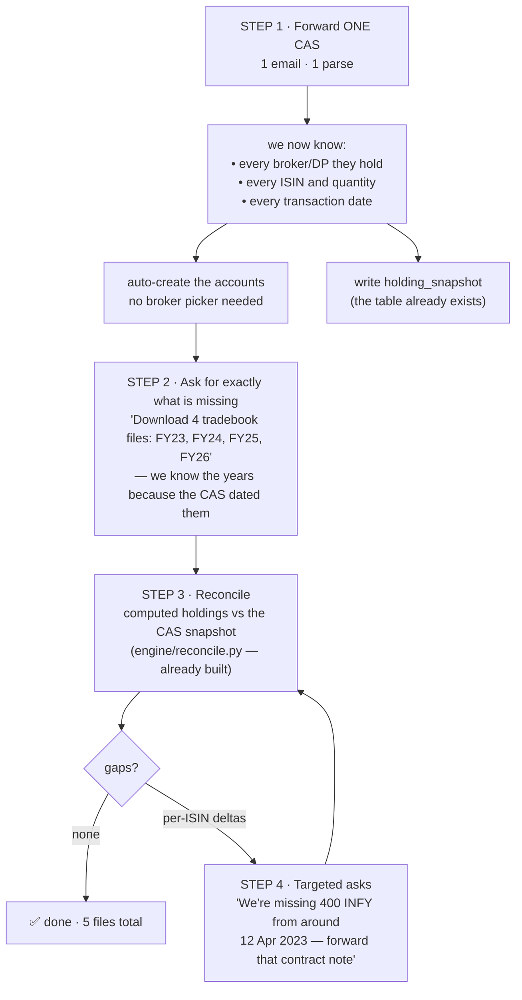
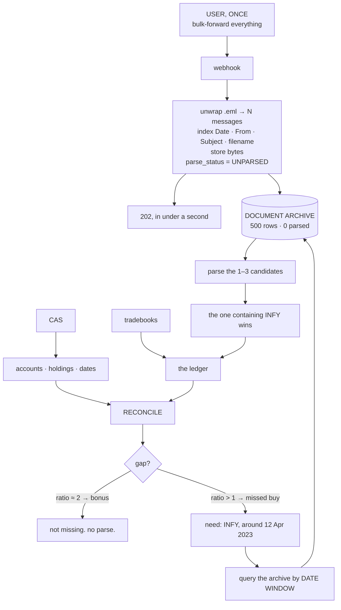

# Backfill strategy — which documents to ask for, and in what order

> Researched 2026-09-07: SEBI circular CIR/MRD/DP/31/2014, CDSL's CAS FAQ, and this
> repo's own prior findings. Supersedes the "forward 500 contract notes" strategy assumed
> in [EMAIL_BACKFILL.md](EMAIL_BACKFILL.md); that document's *plumbing* (async queue,
> `.eml` unwrapping) still stands and is still needed.

---

## 1 · You are right about the efficiency. One premise needs correcting.

> *"CDSL does contain all data required, history as well — why do I need 500 old emails
> when I can do a more efficient job by selecting the best emails?"*

The instinct is correct and it changes the design. But one fact has to be nailed down
first, because the whole plan turns on it:

```
   ┌──────────────────────────────────────────────────────────────────────┐
   │  A CAS DOES NOT CONTAIN EQUITY COST BASIS.                            │
   │                                                                       │
   │  Holdings section:      ISIN · quantity · market price · market value │
   │  Transaction section:   date · security · credit/debit QUANTITY       │
   │                                                                       │
   │  No buy price. No brokerage. No STT. Not for equity, not anywhere.    │
   └──────────────────────────────────────────────────────────────────────┘
```

**This is not a formatting gap that a newer CAS will fix. It is structural:**

```
   WHO KNOWS WHAT

   exchange + broker  ──► the trade      price, quantity, brokerage, STT, stamp duty
        │                                └─► lands on the CONTRACT NOTE
        │
        ▼  T+1 settlement: only the net delivery obligation moves
   depository (CDSL/NSDL) ──► the movement    ISIN, quantity, date, credit or debit
                                              └─► lands on the CAS
```

A depository is a registry of **securities movement**, not of trades. It never sees the
price, because the price is not what settles — the shares are. So there is nothing for it
to print.

> **Why the blogs say otherwise.** Search results claiming "CAS includes cost of
> acquisition" are describing the **mutual fund** half of the CAS, and for MF it is true:
> the RTA (CAMS/KFintech) *is* the transaction processor, knows the purchase NAV, and
> prints it. For demat equity, no such party exists in the chain. Your own
> [INGESTION.md:471](INGESTION.md) already recorded this from earlier research:
> *"CAS PDF — multi-broker holdings; reconciliation gold. **No equity cost basis.**"*

**What this rules out:** CAS alone cannot produce invested amount, XIRR, realised or
unrealised P/L, FIFO lots, or CAGR. That is the entire product. So CAS cannot be the
ledger.

**What it does not rule out:** everything else you were reaching for — and the efficient
plan is better than the one you described.

---

## 2 · What a CAS gives that *nothing else* can

This is the part worth building around. One CAS answers four questions that would
otherwise cost the user a great deal of work:

```
   ONE CAS  (one email, one parse)
      │
      ├─► 1. WHICH BROKERS / DPs DOES THIS PERSON ACTUALLY HAVE?
      │      Consolidated on PAN across BOTH depositories. The single
      │      document that knows about the Groww account they forgot about.
      │
      ├─► 2. WHAT DO THEY HOLD RIGHT NOW, EXACTLY?
      │      Every ISIN, every quantity, across every account.
      │
      ├─► 3. WHICH ISINs AND WHICH DATES MATTER?
      │      The transaction section dates every credit and debit — so you know
      │      precisely which contract notes are worth asking for.
      │
      └─► 4. IS THE IMPORTED LEDGER COMPLETE?
             Computed holdings vs declared holdings, per ISIN. This is the
             completeness proof no broker file can give.
```

Point 1 alone would have answered the multi-broker onboarding question from
[ONBOARDING_AS_IS_VS_TO_BE.md §5](ONBOARDING_AS_IS_VS_TO_BE.md): **you do not have to ask
which brokers someone uses. The CAS tells you.**

---

## 3 · The source matrix

| Source | Files | Price | Charges | Cross-broker | What it is really for |
|---|---|---|---|---|---|
| **CAS** (email) | **1–2** | ❌ | ❌ | ✅ **all of them** | the map: accounts, holdings, dates, completeness |
| Console tradebook (download) | 3–5 (365-day cap per file) | ✅ | ❌ | ❌ one broker | **the ledger** — cheapest complete history with prices |
| Contract notes (email) | 1 per trading day → hundreds | ✅ | ✅ | ❌ one broker | charge-accurate cost basis; gap filling |
| Console P&L (download) | 1 per FY | realised only | partial | ❌ | cross-check |

Read the "Files" column next to the "Price" column and the plan writes itself.

---

## 4 · The plan: CAS is the map, the tradebook is the ledger



**Step 4 is the thing you were actually asking for**, and it is better than selecting
emails by hand: the selection is driven by a **measured gap**, not a guess.
`app/engine/reconcile.py` already turns a quantity delta into a named cause:

| ratio declared/computed | what reconcile.py already concludes |
|---|---|
| ≈ 2, 3, 5, 10 | a bonus or a split — a corporate action, not a missing file |
| computed = 0 | a transfer-in never recorded, or an account we don't know about |
| declared = 0 | a full exit, or an unrecorded transfer-out |
| other > 1 | **a missed buy contract note** ← ask for exactly this one |
| other < 1 | a transfer-out, a buyback, or a missed sell |

So the user is never told "forward everything". They are told *"forward the note for INFY
around 12 April 2023"* — or, more often, *"this is a 1:1 bonus, nothing is missing."*

### The arithmetic

```
   YOUR ORIGINAL PLAN              THIS PLAN
   ──────────────────              ─────────────────────────────
   ~500 emails forwarded           1 CAS email
   ~500 PDFs parsed                + 4 tradebook CSVs (downloaded)
   ~500 import batches             + 0–10 targeted contract notes
   8–25 min of CPU                 ────────────────────────────
   several Gmail pages, by hand    ≈ 5 documents · seconds of CPU
```

And the result is *more* complete, because the CAS covers brokers the tradebook never
sees.

---

## 5 · Almost all of this is already built

The striking part. Every piece of the CAS pipeline exists except the parser itself:

```
   ✅ file_validation.DOC_CAS_PDF            recognises a CAS from its markers
   ✅ imports.stage_batch                    calls adapter.parse_declared_holdings()
                                             if present, and writes the snapshot
                                             [imports.py:272-275]
   ✅ db.holdings.record_snapshot            upserts holding_snapshot rows
   ✅ holding_snapshot table                 "CAS/broker-declared quantities, used to
                                             CHECK the engine" [001_core.sql:139]
   ✅ engine.reconcile.reconcile             computed vs declared, with cause heuristics
   ✅ POST /investors/{id}/reconcile         the endpoint
   ✅ /reconcile page                        the UI

   ❌ app/ingest/cas_pdf.py                  DOES NOT EXIST
      └─ referenced by name in three docstrings as though it does
         (imports.py:138, holdings.py:19, base.py:124)
```

The socket is wired. One adapter plugs into it — `parse()` returning transactions is not
even required; a CAS adapter needs only `parse_declared_holdings()`, and `stage_batch`
already branches on `getattr(adapter, "parse_declared_holdings", None)`.

---

## 6 · The refinement: archive everything, let reconciliation choose what to parse

**The idea:** the user bulk-forwards once. The system stores every message *without
parsing it*. Later, CAS + tradebooks drive reconciliation, and reconciliation points at
the specific stored documents worth opening.

This is strictly better than §4's step 4, and the reason is one word: **§4 asked the
user to go find the missing note. This asks the system to.**



### The schema was already built for exactly this

This is not a new architecture. It is the architecture `document` was designed for and
that nothing currently uses:

```sql
CREATE TABLE document (
    ...
    storage_key       text NOT NULL UNIQUE,   -- the bytes, in object storage
    sha256            text NOT NULL UNIQUE,   -- re-forwarding is a no-op
    source_message_id text,                   -- ← the email it came from
    received_at       date NOT NULL,          -- ← the date index you need
    parsed_at         timestamptz,            -- ← null until it is worth parsing
    parse_status      text NOT NULL DEFAULT 'UNPARSED'   -- ←←← this
);
COMMENT ON TABLE document IS
    'Raw statements as received. Stored BEFORE parsing, always: a parser bug then
     costs a reparse rather than the document itself.';
```

| your plan needs | status |
|---|---|
| store bytes without parsing | ✅ `documents.store_document()` — standalone, idempotent on content hash |
| a "not parsed yet" state | ✅ `parse_status DEFAULT 'UNPARSED'` |
| the source email's identity | ✅ `source_message_id` |
| a date index | ✅ `received_at` |
| re-forward is harmless | ✅ `sha256 UNIQUE`, per investor (migration 020) |
| **sender / subject** | ❌ no columns — add two, or one `email_meta jsonb` |
| **email metadata reaching the DB at all** | ❌ `_translate_mailgun` returns only `recipient` + attachments. Sender, Subject, Date and Message-ID are **discarded at the door** ([webhook_providers.py:130](../trackr-backend/app/ingest/webhook_providers.py#L130)) |
| **anything writing `parse_status`** | ❌ the column is read once and **written by nothing** — it is inert today |
| **archive-only path in the webhook** | ❌ `handle_inbound_email` calls `stage_batch`, which parses immediately |
| **(ISIN, date) → document lookup** | ❌ the selector itself. See below |

### Three things that will break this if they are not designed for

**① Email metadata cannot answer "which ISIN".** The subject and filename give you
*broker* and *date*. They do not tell you INFY is inside — one contract note for 12 Apr
2023 may cover five scrips. So `WHERE symbol = 'INFY'` is not answerable from the index.

It does not need to be. The CAS dates every movement, so **select by date window, parse
the one to three candidates, and let the parsed content confirm.** Parsing three notes
instead of one costs nothing and removes the need for a cleverer index.

**② CAS dates are settlement dates, not trade dates.** A buy executed on 12 April credits
the demat on T+1 — and for trades before Indian equities completed the move to T+1 rolling
settlement in early 2023, T+2. Add weekends and exchange holidays and exact-date matching
misses more often than it hits.

```
   ❌ note_date == cas_date - 1              fragile, and the offset changed in 2023
   ✅ note_date BETWEEN cas_date - 4         cheap, and correct regardless of
                    AND cas_date             settlement-cycle history
      then parse the candidates and let ISIN + quantity decide
```

Do not encode a settlement offset. `CLAUDE.md` forbids inventing financial rules that
`ENGINE_SPEC` does not state, and this one has a moving history — a window sidesteps it
entirely.

**③ The 490 notes you never parse are where the charges live.** This is the real cost of
"parse only what reconciliation flags", and your own repo has already measured it:

> *"146 of 259 tradebook trades are also described by a contract note … A contract note
> beats a tradebook, because the note carries CHARGES and the tradebook does not.
> Preferring the tradebook would import the same trade with a cost basis understated by
> its brokerage, STT, GST and stamp duty — **8,278.12 across the 40 real notes here**."*
> — [db/precedence.py](../trackr-backend/app/db/precedence.py)

A gap-only parse leaves every non-gap trade priced from the tradebook, with no charges.
Invested comes out too low and XIRR too high — quietly, across the whole portfolio.

**And the archive is exactly what fixes it.** Parse the flagged documents *now*, and
background-parse the rest at leisure — nobody is waiting, so it can trickle. Each
late-parsed note then upgrades its tradebook row, and **that path is already
implemented**:

```
   contract note parsed months later
        │
        ▼
   precedence.existing_identities(conn, account_id)   ← reads the LIVE ledger,
        │                                                not just this batch
        ▼
   decide() → ACTION_SUPERSEDE
        │
        ▼
   _reversals_for(...)  →  a REVERSING entry, never an UPDATE
        │                   raw_payload: "superseded by a higher-precedence source;
        ▼                    the original was TRADEBOOK and carried no charges"
   append-only ledger intact, cost basis corrected
```

`imports.py:561-590` and `imports.py:700-720`. The hardest correctness problem in your
plan — *a better document arriving after the ledger was already written* — is solved,
tested, and honours the append-only rule.

### So the reframe

> **The goal is not to avoid parsing 500 PDFs. It is to avoid anyone waiting for it.**

Your architecture achieves that, and the charge argument says you should eventually parse
them all anyway — just never in a webhook, and never while someone watches a spinner.
Reconciliation decides the *order*: the documents that close a real gap go to the front of
the queue, and the rest drain behind them.

### One free synergy

The `.eml` unwrapping the fallback path needed is also what supplies the index. Gmail's
bulk "Forward as attachment" nests each original message, and `email.message_from_bytes`
hands you its `Date`, `From`, `Subject` and `Message-ID` — the exact four fields the
archive wants — from the *original* email rather than from the forwarding wrapper. One
twenty-line function serves both purposes.

---

## 7 · The scope decision you have to make on purpose

`CLAUDE.md` line 55 lists **"CAS parsing"** under *Out of Phase 1*. `INGESTION.md` lists
CAS PDF under *"Phase 2+ adapters (design the seam, do not build)"*.

That was a correct call at the time, on the reasoning that CAS carries no cost basis and
therefore cannot feed the ledger. **The reasoning is still true; the conclusion no longer
follows** — because the value of a CAS is not the ledger, it is:

- knowing which accounts exist (which onboarding currently *asks* the user, badly), and
- proving the ledger is complete (which nothing else can do).

So: promote CAS parsing into Phase 1, **as a holdings-and-discovery adapter only, never as
a transaction source.** That distinction has to be written into `CLAUDE.md` and
`INGESTION.md` in the same commit, or it will drift into someone deriving cost from a CAS,
which would be silently wrong in a way that takes days to find.

Proposed wording for the scope line:

> *CAS parsing — **in** Phase 1, restricted to `parse_declared_holdings()`. A CAS may
> write `holding_snapshot` and may create accounts. It may **never** produce a
> `Transaction`: it carries no price, and a transaction without a price is not a
> transaction.*

---

## 8 · Five caveats that will bite if they are not designed for

**① Intraday trades are invisible to a CAS.** Buy and sell on the same day nets to zero
delivery, so nothing moves in the demat and nothing appears on the statement. A CAS
reconciliation will therefore agree perfectly with a ledger that is missing every intraday
trade. Fine for holdings; useless as a completeness proof for realised P/L.

**② One CAS = one period's transactions.** Monthly *only when there was a transaction*;
otherwise half-yearly (September and March). So the latest CAS gives you current holdings,
but transaction *history* needs one CAS per month — about 36 emails for three years,
against ~450 contract notes. Better, but still no prices, which is why the tradebook stays
the ledger source.

**③ Same PAN blocker.** CDSL's own FAQ: the eCAS opens with *"PAN of the first/sole demat
account holder in CAPITAL letters"*. Identical to the contract-note rule, and equally
fatal — no PAN captured in the UI means no CAS opens either. This remains the single
highest-priority fix in the whole ingestion story.

**④ Only one depository sends it.** Where a person holds accounts in both CDSL and NSDL,
the depository holding the **earlier-opened** demat account is the default sender and
consolidates across both (SEBI CIR/MRD/DP/31/2014, ¶5). So one CAS really does cover
everything — but the person may have to be told which of the two mails it to them.

**⑤ The declared holding is dated.** `holding_snapshot` is keyed
`(account_id, isin, snap_date)`. Reconciling today's computed holdings against a March CAS
compares two different dates and will produce phantom discrepancies. Always reconcile as
of the CAS's own statement date.

---

## 9 · What this does to the Celery question

It largely dissolves it.

```
   volume under "forward everything"        volume under CAS-first
   ────────────────────────────────         ──────────────────────
   50–100 PDFs per inbound message          1 CAS PDF per message
   25–200 s of CPU in one webhook           1–3 s
```

The **split still matters** — a webhook must answer in seconds because Mailgun retries a
slow one, and a CAS is still a multi-page PDF parsed under an HTTP request. But the
Postgres `SELECT … FOR UPDATE SKIP LOCKED` queue from
[EMAIL_BACKFILL.md §6](EMAIL_BACKFILL.md) is now obviously, comfortably sufficient, and
Redis + Celery is clearly premature. Keep bulk forwarding as the **fallback** for someone
whose broker console is unavailable — that is when the `.eml` unwrapping and the queue
earn their keep.

---

## 10 · Build order

```
   ┌── UNBLOCKS EVERYTHING ─────────────────────────────────────────────┐
   │ capture PAN in onboarding             ~2 hours   CAS and contract  │
   │                                                  notes can OPEN    │
   └────────────────────────────────────────────────────────────────────┘
   ┌── THE NEW STRATEGY ────────────────────────────────────────────────┐
   │ scope decision written into CLAUDE.md  ~30 min   deliberate, not   │
   │ + INGESTION.md                                   drift             │
   │ app/ingest/cas_pdf.py — holdings only  ~1–2 days plugs into a      │
   │   parse_declared_holdings() ONLY                 finished socket   │
   │ auto-create accounts from the CAS      ~half day no broker picker  │
   │ reconcile as of the CAS's own date     ~2 hours  no phantom gaps   │
   │ "what's still missing" screen driven   ~1 day    targeted asks,    │
   │   by reconcile.py's cause heuristics             not "forward all" │
   └────────────────────────────────────────────────────────────────────┘
   ┌── THE ARCHIVE (§6) — enables bulk forward AND fixes charges ───────┐
   │ .eml unwrapping + header extraction    ~30 lines bulk forward, and │
   │                                                  the index, at once│
   │ keep sender/subject/msg-id through     ~20 lines metadata survives │
   │   _translate_mailgun → 2 columns                 the door          │
   │ archive-only webhook path; actually    ~half day 202 in <1s,       │
   │   write parse_status                             nothing parsed    │
   │ Postgres job queue, reconciliation-    ~1 day    gaps first, the   │
   │   ordered                                        rest trickle      │
   │ (ISIN, date-window) → document lookup  ~half day the selector      │
   │ delivery_id + "promote all"            ~half day 1 click, not 500  │
   └────────────────────────────────────────────────────────────────────┘
```

**The one-line version:** the user hands over their document universe **once**; the CAS
says which accounts and holdings exist; the tradebooks fill the ledger; reconciliation
decides which stored documents are worth opening and in what order — and the user is never
asked to go looking through their inbox again.

---

## Sources

- [SEBI Circular CIR/MRD/DP/31/2014 — Consolidated Account Statement for all securities assets](https://www.cdslindia.com/downloads/Publications/Communique/DP-4816-SEBI-Circular-CAS-for-All-Securities-Assets.pdf) (PAN-based consolidation; monthly on transaction, half-yearly otherwise; default depository rule)
- [CDSL — CAS FAQ](https://www.cdslindia.com/cas/FAQ.html) (eCAS password = PAN in capitals; dispatch frequency)
- [NSDL — Know your CAS](https://nsdl.com/investor/know-your-cas) (dispatch schedule; asset classes covered)
- [Junction Unbox — Reading the NSDL/CDSL CAS report](https://www.junctionunbox.com/consolidated-account-statement-cas-nsdl-cdsl-report/) (closing value is quantity × closing market price, not cost; use the broker P&L for cost basis)
- [Zerodha — What is CAS](https://support.zerodha.com/category/console/portfolio/statement/articles/what-is-cas)
- This repo: `docs/INGESTION.md` ("No equity cost basis"), `CLAUDE.md` line 55 (Phase 1 scope), `app/engine/reconcile.py` (cause heuristics)
