# Bulk historical backfill by email — and whether it needs Celery

> **⚠️ Strategy superseded — read [BACKFILL_STRATEGY.md](BACKFILL_STRATEGY.md) first.**
> This document assumes "forward every old contract note". A CAS-first approach needs
> ~5 documents instead of ~500, so bulk forwarding is now the **fallback**, not the plan.
> Everything below about the *plumbing* — `.eml` unwrapping, the async split, the queue
> choice, the PAN blocker — still stands and is still needed for that fallback.
>
> Written 2026-09-07 against `backup-safe-checkpoint`. Companion to
> [ONBOARDING_FLOW.md](ONBOARDING_FLOW.md) (the mail plumbing) and
> [ONBOARDING_AS_IS_VS_TO_BE.md](ONBOARDING_AS_IS_VS_TO_BE.md) (the signup journey).

---

## 1 · The plan, and why it is a good one

> *"Tell them go to search, use a Zerodha filter, select all, and forward everything to
> the forwarding address."*

This is right, and it is worth being precise about **why** it is right rather than just
convenient:

```
   what a contract note carries          what a tradebook carries
   ──────────────────────────────        ──────────────────────────────
   ISIN, quantity, price          ✅     ISIN, quantity, price          ✅
   brokerage                      ✅     —                              ❌
   STT, stamp duty, exchange fees ✅     —                              ❌
   GST, SEBI charges              ✅     —                              ❌
```

`docs/INGESTION.md` puts it plainly: of everything Zerodha emails, the Combined Equity
Contract Note is **"the only one with price"**. Charges belong in cost basis, and cost
basis is what every number in this product is built on. So a mailbox full of three years
of contract notes is not a second-best source of history — for cost accuracy it is
**better** than the Console tradebook.

### One correction to the plan

**Tradebooks are not emailed.** Zerodha mails contract notes (per trading day), weekly
account statements, monthly demat statements, exchange balance mails and quarterly
retention statements — no tradebook. The tradebook is a Console *download*, capped at 365
days per file. So:

```
   FROM EMAIL (the search-and-forward plan)     FROM CONSOLE (download, upload)
   ─────────────────────────────────────        ──────────────────────────────
   contract notes, with charges  ⭐             tradebook CSV, one file per year
   → the accurate cost basis                    → fast, complete, no charges
```

Both paths should exist and the UI should say which gives what. Neither replaces the
other.

---

## 2 · Four things break before Celery is even the question

Ordered by how quietly each one fails.

### 🔴 Blocker A — no PAN on file, so **every** contract note fails to open

This is the one that would waste a weekend. Zerodha's contract-note PDFs are password
protected with the investor's PAN in **uppercase**
([webhook.py:31](../trackr-backend/app/ingest/webhook.py#L31)). The lookup is:

```
   pdf_password(conn, investor_id, broker)
        │
        ├─ no PAN row?  →  returns ""          [webhook.py:126]
        │                        │
        │                        ▼
        │              pdfplumber cannot open the file
        │                        │
        │                        ▼
        │              ⚠️ 500 forwarded notes → 500 failures, one per batch
```

**The UI never asks for a PAN.** The backend has both routes —
`POST /investors` accepts `pan` write-only, and `POST /investors/{id}/pan` exists
([investors.py:78](../trackr-backend/app/routers/investors.py#L78)) — and the storage is
built properly (encrypted in `investor_secret`, peppered hash for matching, never on the
`investor` row). But no screen in the frontend collects it: registration doesn't ask, the
Settings investor form has Code / Display name / Family group / Onboarding date and no
PAN field, and the wizard creates the account with `client_id: null` and no PAN at all.
The only place the frontend mentions PAN is the Privacy page, which *exports* it.

**Fix before anything else in this document.** One field, in wizard screen 2, next to the
broker: *"Your PAN — brokers lock contract notes with it, and it never leaves us
unencrypted."* It is also what makes the identity check in
[ONBOARDING_AS_IS_VS_TO_BE.md §2](ONBOARDING_AS_IS_VS_TO_BE.md) work at all.

### 🔴 Blocker B — Gmail's bulk forward wraps everything in `.eml`

Selecting many messages and choosing **Forward as attachment** produces *one* email whose
attachments are `message/rfc822` files. The PDF is nested one level inside each:

```
   one forwarded message
   ├── 01.eml   → From: Zerodha … ├── contractnote-2023-04-12.pdf   ← what we want
   ├── 02.eml   → From: Zerodha … ├── contractnote-2023-04-13.pdf
   └── …
```

Nothing unwraps that. `file_validation.classify` sniffs the container of each attachment,
finds neither PDF nor CSV nor XLSX, and rejects all of them with a polite sentence. This
is **L6** in the loophole register — about twenty lines in `handle_inbound_email`
(`email.message_from_bytes`, recurse into nested parts) and it is the difference between
this plan working and not existing.

### 🟠 Blocker C — 500 PDFs become 500 separate things to approve

`import_batch` is **one row per file** — there is no grouping column
([005_import_batch.sql:11](../trackr-backend/app/db/migrations/005_import_batch.sql#L11)).
Nothing auto-commits, by design, so someone has to promote each batch. Today that means:

```
   Import page
   ├── batch a1b2…  contractnote-2023-04-12.pdf   3 rows   [Review] [Promote]
   ├── batch c3d4…  contractnote-2023-04-13.pdf   1 row    [Review] [Promote]
   ├── … × 498
```

**Fix:** a `delivery_id` on `import_batch` (the inbound message id), and one *"Promote all
487 documents from this delivery"* action with a single summary. The staging rule is
untouched — a human still makes one explicit, attributed decision. It just isn't five
hundred of them.

### 🟠 Blocker D — the actual reason you asked about Celery

500 PDFs cannot be parsed inside an HTTP request. That part of your instinct is exactly
right. The rest of this document is about what to do instead.

---

## 3 · The Gmail mechanics, precisely

What the walkthrough has to say, because getting this wrong wastes the user's afternoon:

```
   1  Gmail → Settings → gear → "Maximum page size: 100 conversations"
   2  Search:  from:(noreply@zerodha.net) subject:("contract note") has:attachment
   3  Select-all checkbox at the top of the page  (this selects the PAGE, not all results)
   4  ⋮ (three dots) → "Forward as attachment"
   5  To: your Trackr+ address → Send
   6  Next page → repeat from 3
```

Three limits that shape the copy:

| limit | value | what it means for the UI |
|---|---|---|
| Gmail page size | 100 conversations | the loop is per page, not one click. Say so |
| Attachment size | 25 MB per message | ~100 notes at ~150 KB each is near the ceiling |
| Mailgun forward | 25 MB, matching `INGEST_MAX_ATTACHMENT_BYTES` | oversize is refused with 413 before the body is read |

**Overlap is free, and this is the quiet hero of the whole plan.** `import_batch.sha256` is
`UNIQUE`, so re-forwarding a page you already sent raises `DuplicateUploadError` and is
reported inline as "already staged" rather than double-importing
([webhook.py:195](../trackr-backend/app/ingest/webhook.py#L195)). Users can be told
*"if you lose your place, just forward the page again"* — and that is true, not a hope.

---

## 4 · The load, honestly

Rough numbers for someone trading three times a week for three years — estimates, not
measurements, but the right order of magnitude:

```
   ~450 contract notes
        × ~0.3–2 s each to unlock + parse (pdfplumber, a 1–3 page note)
        = 2–15 minutes of CPU, once, at signup

   arriving as ~5–9 forwarded messages
        = 50–100 PDFs in a single webhook delivery
        = 25–200 s of work inside one HTTP request
```

```
   ┌────────────────────────────────────────────────────────────────┐
   │  Mailgun's rule: any non-2xx or a timeout means RETRY.          │
   │  A slow webhook is not "slow" — it is a message delivered       │
   │  again, and again, on a backoff, for hours.                     │
   └────────────────────────────────────────────────────────────────┘
```

So the split below is not an optimisation. It is the only shape that works.

---

## 5 · The split that matters (this part is not optional)

```mermaid
flowchart LR
    A["Mailgun POST<br/>/ingest/email"] --> B

    subgraph FAST["webhook · must answer in seconds · I/O only"]
      B["verify HMAC signature"] --> C["unwrap .eml → N attachments"]
      C --> D["store raw bytes<br/>(object storage)"]
      D --> E["INSERT one job row<br/>per attachment"]
      E --> F["202 Accepted"]
    end

    F --> G

    subgraph SLOW["worker · CPU · takes as long as it takes"]
      G["claim a job"] --> H["unlock PDF with PAN"]
      H --> I["adapter.parse()"]
      I --> J["stage_batch → STAGED"]
      J --> G
    end

    J --> K["Import page:<br/>'487 documents from your<br/>Gmail backfill' — one Promote"]
```



Two properties this gives you for free:

- **Storing before parsing is already the design.** `stage_batch` writes the raw bytes to
  the document store *before* it parses ([webhook.py:9](../trackr-backend/app/ingest/webhook.py#L9)).
  Splitting the parse out does not change what is durable — it only changes when.
- **Jobs are idempotent without effort.** A worker that dies mid-document leaves nothing
  half-written, and re-running the job hits the `sha256 UNIQUE` and reports "already
  staged". Retry safety is a property of the schema, not of the queue.

---

## 6 · Celery + Redis, or Postgres? — the honest comparison

**The constraint that decides it:** this app deploys to **Vercel**, as two projects from
one repo, with Vercel Cron running the two daily `/ops/*` jobs
([DEPLOYMENT.md](DEPLOYMENT.md), [vercel.json](../trackr-backend/vercel.json)).

```
   ┌──────────────────────────────────────────────────────────────────┐
   │  Celery needs a long-running worker process.                      │
   │  Vercel has no worker runtime.                                    │
   │                                                                   │
   │  So "add Celery" is not a library decision. It is:                │
   │    + a second always-on host (Fly / Railway / Render / a VPS)     │
   │    + a Redis instance                                             │
   │    + a second deploy pipeline and a second set of secrets         │
   │    + a monthly bill and something new to be paged about           │
   └──────────────────────────────────────────────────────────────────┘
```

| | **Postgres job table**<br/>`SELECT … FOR UPDATE SKIP LOCKED` | **Redis + Celery** |
|---|---|---|
| New infrastructure | **none** — Postgres is already there and pooled | a worker host **and** Redis |
| Works on today's deploy | ✅ yes | ❌ no — needs to leave Vercel |
| New secrets / bills | none | broker URL, backend URL, host, Redis |
| Retries & backoff | columns you write (~30 lines) | ✅ built in |
| Scheduling, chords, rate limits | ❌ you'd be building Celery | ✅ its whole point |
| Concurrency | a handful of workers | ✅ many, trivially |
| Inspecting a stuck job | `SELECT * FROM job WHERE status='FAILED'` | Flower, or another tool |
| Transactional with the import | ✅ same database, same transaction | ❌ two systems that can disagree |
| Ops burden | none beyond Postgres | a broker to monitor, workers to restart |

### The recommendation

**Build the split now. Start with the Postgres queue. Keep it behind an interface.**

```python
# app/jobs/queue.py  — the whole surface area worth committing to
def enqueue(conn, kind: str, payload: dict) -> str: ...
def claim(conn, limit: int) -> list[Job]: ...   # FOR UPDATE SKIP LOCKED
def complete(conn, job_id: str) -> None: ...
def fail(conn, job_id: str, error: str) -> None: ...
```

Four functions. Swapping the body for `celery_app.send_task(...)` later is a module, not a
refactor — the same way `app/storage/factory.py` already lets local and S3 swap.

**Why Postgres wins *for this workload specifically*:** it is a burst, not a stream. One
user backfills once, at signup, and then the address handles a couple of contract notes a
week forever. A queue sized for 500-documents-once should not cost a permanent second host.
And "the job row and the import batch commit in the same transaction" is a real
correctness advantage that a separate broker cannot give you.

**Draining it on Vercel**, two options:

```
   a) Vercel Cron tick        GET /ops/cron/jobs-drain  → process a bounded batch
      simple; latency = the cron interval
      ⚠️ Vercel Cron is once-per-DAY on Hobby; minute-level needs Pro

   b) Self-chaining           webhook returns 202, then fires a fire-and-forget
      request to /ops/jobs/drain, which processes until near its time budget and
      re-triggers itself while jobs remain
      minutes not hours, still zero new infrastructure
```

Do **(a)** as the safety net that guarantees nothing is ever stranded, and **(b)** for
responsiveness. They are complementary, not alternatives.

### When to actually switch to Celery

Not on a feeling — on one of these:

- you have moved the backend off Vercel and a worker host exists anyway (the deployment
  doc explicitly keeps this exit open: *"a normal FastAPI app that runs unmodified under
  uvicorn anywhere"*);
- more than a handful of investors are backfilling at once, and a bounded batch per tick
  stops keeping up;
- you need real scheduling — retries with exponential backoff at volume, rate-limited
  fan-out to a third-party API, periodic chains;
- the LLM extraction path (`LLM_PARSING_ENABLED`) goes live, which turns every unrecognised
  document into a slow, rate-limited, genuinely queue-shaped external call.

That last one is the most likely trigger. Until then, Celery would be infrastructure you
operate rather than infrastructure you use.

---

## 7 · One security note before opening this door

Bulk forwarding makes the inbound address a much more attractive target: a single message
can now stage hundreds of documents. Two mitigations, both already half-built:

- **L9 — make the address unguessable.** `praveen-a3f2-…` is derived from the email stem.
  An opaque per-account token costs one column and removes the guess entirely.
- **Per-document identity checks still run on every attachment.** `app/db/identity.py`
  compares each document's PAN and UCC against the account before anything is staged, and
  a mismatch is refused and audited per attachment rather than failing the whole delivery
  ([webhook.py:207](../trackr-backend/app/ingest/webhook.py#L207)). That behaviour is
  exactly right for bulk and needs no change.

Also add a cap: refuse a delivery above *N* attachments with a clear message, rather than
enqueueing ten thousand jobs because someone forwarded their entire mailbox.

---

## 8 · Build order

```
   ┌── WITHOUT THESE, BULK BACKFILL CANNOT WORK AT ALL ─────────────────┐
   │ A  capture PAN in onboarding          ~2 hours   PDFs can open     │
   │ B  unwrap .eml attachments            ~20 lines  bulk arrives      │
   │ L2 capture Gmail's confirmation code  ~80 lines  forwarding starts │
   └────────────────────────────────────────────────────────────────────┘
   ┌── MAKES IT SURVIVABLE ─────────────────────────────────────────────┐
   │ D  job table + enqueue/claim/complete  ~half day  no timeouts      │
   │ D  webhook does I/O only, returns 202  ~2 hours   no retry storms  │
   │ D  drain: cron tick + self-chaining    ~half day  minutes, not days│
   │ C  delivery_id + "promote all"         ~half day  1 click, not 500 │
   └────────────────────────────────────────────────────────────────────┘
   ┌── MAKES IT SAFE ───────────────────────────────────────────────────┐
   │    per-delivery attachment cap         ~1 hour    no mailbox bombs │
   │ L9 unguessable address token           migration  no guessing      │
   │ L8 2xx on permanent failures           ~10 lines  no retry storms  │
   └────────────────────────────────────────────────────────────────────┘
   ┌── LATER, IF THE TRIGGERS FIRE ─────────────────────────────────────┐
   │    swap queue.py's body for Celery     ~1 day + infrastructure     │
   └────────────────────────────────────────────────────────────────────┘
```

**Blocker A is the one to do first.** Everything else in this document is architecture;
that one is a missing text field, and without it the entire contract-note path — bulk or
single, email or upload — fails on every single document.
