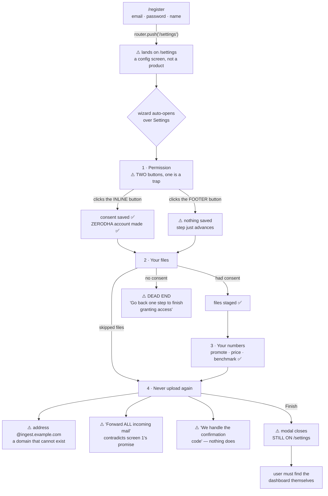
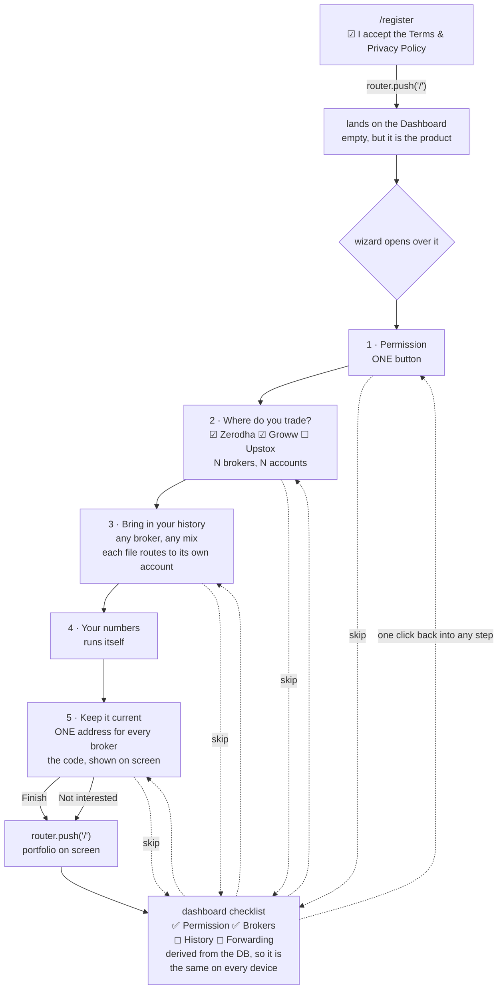

# Onboarding: how it is vs. how it should be

> Traced 2026-09-07 from the code on `backup-safe-checkpoint`, click by click, from
> "Create account" to a working dashboard. Every box below is a real screen and every
> ⚠️ is a real line of code, named.
>
> Companion doc: [ONBOARDING_FLOW.md](ONBOARDING_FLOW.md) — the mail plumbing
> (inbound domain vs forwarding address) and the consent-vs-terms distinction in depth.

---

## 1 · The whole journey on one page

### 🔴 AS IT IS TODAY



### 🟢 HOW IT SHOULD BE



> **Two rules the diagram encodes.** Every step has a dotted line out of it — only the
> terms checkbox is mandatory. And *Finish* and *Not interested* land in the same place:
> declining forwarding is a completed setup, not an abandoned one.

---

## 2 · Screen by screen

### Screen 0 — Create account

```
   AS IT IS                                  HOW IT SHOULD BE
   ┌────────────────────────────────┐        ┌────────────────────────────────┐
   │  Create an account             │        │  Create an account             │
   │                                │        │                                │
   │  Name      [            ]      │        │  Name      [            ]      │
   │  Email     [            ]      │        │  Email     [            ]      │
   │  Password  [            ]      │        │  Password  [            ]      │
   │  Confirm   [            ]      │        │  Confirm   [            ]      │
   │                                │        │                                │
   │      [ Create account ]        │        │  ☑ I accept the Terms of       │
   │                                │        │    Service and Privacy Policy  │
   │                                │        │      ← MISSING TODAY           │
   │                                │        │                                │
   │                                │        │      [ Create account ]        │
   └────────────────────────────────┘        └────────────────────────────────┘
              │                                          │
              ▼                                          ▼
        →  /settings   ⚠️                          →  /   (Dashboard)
```

| | As it is | Should be |
|---|---|---|
| Terms / Privacy acceptance | ❌ nowhere in the product | ☑ required checkbox, version stamped on `app_user` |
| Creates an investor | ✅ yes — `create_personal_investor` | ✅ unchanged |
| Investor code | auto: `PRAVEEN-A3F2` (email stem + random) | ✅ unchanged, but see loophole L9 |
| Lands on | ⚠️ `/settings` — [register/page.tsx:31](../trackr-frontend/app/register/page.tsx#L31) | `/` — the dashboard |

> **Why `/settings` is wrong.** It is the most technical screen in the app — investor
> codes, family group IDs, DP IDs. It is the *first* thing a new user sees. The wizard
> then opens on top of it, so the moment they close or skip the modal they are staring at
> a form asking for a "Family group ID". Nothing about that says "portfolio tracker".

---

### Screen 1 — Permission

```
   AS IT IS                                          HOW IT SHOULD BE
   ┌──────────────────────────────────────┐          ┌──────────────────────────────────────┐
   │ Let's set up your portfolio          │          │ Your permission, before anything else│
   │ First, your permission to read the   │          │ We need your OK to read the          │
   │ statements you send us. This takes   │          │ statements you send us. Here is      │
   │ ONE CLICK ⚠️ (it takes two)          │          │ exactly what that covers.            │
   │                                      │          │                                      │
   │ 🔒 We never ask for your broker pwd  │  ✅ true │ 🔒 We never ask for your broker login│
   │ 📄 You choose what we see —          │          │ 📄 You decide what reaches us —      │
   │    "nothing else in your account"    │  ⚠️ not  │    files you upload, or a rule that  │
   │                                      │    true  │    forwards ONLY broker statements   │
   │ 🗑 Undo any time — "we stop          │  ⚠️ half │ 🗑 Turn it off whenever — we stop    │
   │    processing immediately"           │    true  │    processing at once; erase what's  │
   │                                      │          │    stored on the Privacy page        │
   │ ▸ Read the exact wording             │          │ ▸ Read the exact wording             │
   │                                      │          │                                      │
   │ ┌──────────────────────────────────┐ │          │ ┌──────────────────────────────────┐ │
   │ │   Allow and continue  ›          │ │ ← WORKS  │ │   Allow and continue  ›          │ │
   │ └──────────────────────────────────┘ │          │ └──────────────────────────────────┘ │
   │ ──────────────────────────────────── │          │ ──────────────────────────────────── │
   │ I'll do this later  [Allow&continue] │ ← ⚠️ TRAP│ I'll do this later                   │
   └──────────────────────────────────────┘          └──────────────────────────────────────┘
```

**The trap, precisely.** The footer button is in the position every wizard on earth puts
its primary action. Its `onClick` is
[OnboardingWizard.tsx:160-167](../trackr-frontend/app/components/onboarding/OnboardingWizard.tsx#L160-L167)
and all it does is `setStepIndex(stepIndex + 1)`. It never calls `grant()`. Meanwhile the
identical-looking inline button
([GrantAccessStep.tsx:208](../trackr-frontend/app/components/onboarding/GrantAccessStep.tsx#L208))
is the one that actually does the work:

```
  clicked the INLINE button              clicked the FOOTER button
  ─────────────────────────              ──────────────────────────
  POST /investors/{id}/consent  ✅       (nothing)                  ❌
  → client_consent row written           → no row
  POST /investors/{id}/accounts ✅       (nothing)                  ❌
  → ZERODHA account created              → no account
  onGranted() → step 2                   setStepIndex(1) → step 2
                                              │
                                              ▼
                                    every later upload → 403
                                    step 4 → "No forwarding address yet"
```

**That is your "it doesn't save to the DB" bug.** It is not a persistence problem. It is
two buttons where there should be one.

---

### Screen 2 — Which brokers? (plural)

```
   AS IT IS                                 HOW IT SHOULD BE
   ┌───────────────────────────┐            ┌────────────────────────────────────────┐
   │                           │            │  2 · Where do you trade?               │
   │   (no such screen)        │            │  Tick every broker you use. You can    │
   │                           │            │  add more at any time.                 │
   │   screen 1 silently       │            │                                        │
   │   creates ONE account:    │            │  ☑ Zerodha     notes ✅ book ✅ email ✅ │
   │                           │            │  ☑ Groww       files ✅ email —         │
   │      broker: "ZERODHA"    │            │  ☐ Upstox      files ✅ email —         │
   │                           │            │  ☐ Angel One   files ✅ email —         │
   │   ⚠️ a Groww user is given │            │  ☐ Other  [ name it            ]       │
   │      a Zerodha account    │            │                                        │
   │      and never asked      │            │  ▸ what do these ticks mean?           │
   │                           │            │                                        │
   │                           │            │  [ Continue ]    I'll do this later    │
   └───────────────────────────┘            └────────────────────────────────────────┘
```

**Every ticked broker becomes its own `account` row**, and each one gets its own
forwarding address, its own PDF password rule, and its own place for files to land. One
investor, N accounts — the schema has always allowed this
([001_core.sql:37](../trackr-backend/app/db/migrations/001_core.sql#L37), `account` is a
plain many-to-one on `investor`). Nothing in the database needed to change; only the UI
ever assumed one.

**The badges are load-bearing and must not flatter.**

| badge | means | true today for |
|---|---|---|
| `notes ✅` | contract-note PDFs parse deterministically | Zerodha only ([webhook.py:41](../trackr-backend/app/ingest/webhook.py#L41)) |
| `book ✅` | tradebook CSV/XLSX parses | Zerodha only |
| `files ✅` | files are accepted and classified; unrecognised ones are named honestly, not swallowed | every broker |
| `email ✅` | a forwarding address exists for this broker | only brokers with an adapter |
| `email —` | no address is offered — the row says so instead of showing a dead one | everyone else |

That last row is the difference between multi-broker and *pretending* to be multi-broker.
`EmailForwardingSetup` already gets this right — a broker with no adapter is told so in
plain words rather than handed an address that would bounce
([EmailForwardingSetup.tsx:30](../trackr-frontend/app/components/EmailForwardingSetup.tsx#L30)).
The broker picker must inherit that honesty, and the list must come from the backend,
which is the only side that knows which adapters exist.

---

### Screen 3 — Your history, across every broker at once

```
   AS IT IS                                 HOW IT SHOULD BE
   ┌───────────────────────────┐            ┌────────────────────────────────────────┐
   │  drop zone ✅              │            │  3 · Bring in your history             │
   │  per-file outcomes ✅      │            │  Any broker, any mix, all at once.     │
   │  classifies each file ✅   │            │  ┌──────────────────────────────────┐  │
   │  stages, never commits ✅  │            │  │      drop your files here        │  │
   │                           │            │  └──────────────────────────────────┘  │
   │  ⚠️ every file lands in    │            │                                        │
   │     accounts[0] —         │            │  ✓ tradebook-FY24.csv  → Zerodha · 188 │
   │     whatever that is      │            │  ✓ contractnote-may.pdf → Zerodha ·  12 │
   │                           │            │  ✓ groww-holdings.xlsx  → Groww   ·  41 │
   │  ⚠️ help text names only   │            │  ? tradebook-old.csv    → which account?│
   │     Zerodha Console       │            │       [ Zerodha ▾ ]  ← asked, not guessed│
   │                           │            │  ✗ cas-jul.pdf  a CAS — we can't read   │
   │                           │            │       these yet. Nothing was imported.  │
   └───────────────────────────┘            └────────────────────────────────────────┘
```

**How a file finds its own account.** None of this needs new machinery — it needs the
machinery that already exists, pointed one step further:

```
   ┌─ the file ─────────────────────────────────────────────────────────────┐
   │ 1. classify the bytes        file_validation.classify()                │
   │    → tradebook_csv | contract_note_pdf | contract_note_xlsx | cas_pdf  │
   │      | tradebook_xlsx | unknown            ← already built, already    │
   │                                              distinguishes all six     │
   │ 2. read who it says it is    DocumentIdentity{ pan, client_code }      │
   │    → the broker's UCC, printed on the document                         │
   │                                              ← already built           │
   │ 3. match UCC to account.client_id            ← already built, in       │
   │                                                 app/db/identity.py     │
   └────────────────────────────────────────────────────────────────────────┘
              │
              ├── exactly one account matches      → route there.            ✅
              │
              ├── no account has a client_id yet,
              │   and exactly one account exists
              │   for that document's broker       → bind the UCC to it,
              │                                       once, and route there. ✅
              │
              └── ambiguous, or nothing matches    → DO NOT GUESS.
                                                     one dropdown, one click. ⚠️
```

> **Why PAN cannot do this job.** PAN is per *investor*, not per account — all three of
> your broker accounts carry the same one. It proves the document is yours; it cannot say
> which account it belongs to. Only the broker's own client code (UCC) can, and
> `account.client_id` is exactly where that is already stored
> ([001_core.sql:41](../trackr-backend/app/db/migrations/001_core.sql#L41)).
>
> Today the wizard creates accounts with `client_id: null`, so there is nothing to match
> against. Step 2 of the routing rule above — *learn the UCC from the first document that
> states it* — is what makes the column populate itself without ever asking the user for a
> number they would have to go and look up.

**Two honest limits to keep in view.** The classifier's markers are Zerodha-shaped today,
so a Groww contract note currently classifies as `unknown` and falls to the dropdown (or
the LLM path, where enabled) rather than routing itself. And `cas_pdf` is recognised
precisely so it can be *refused with a sentence* — CAS parsing is out of Phase 1, and
recognising a document you cannot parse is the honest answer, not a gap.

---

### Screen 4 — Your numbers

```
   AS IT IS  ═  HOW IT SHOULD BE          ← this screen is already right
   ┌────────────────────────────────────┐
   │  4 · Working out where you stand   │
   │                                    │
   │  ✓ Adding your trades   324 added  │
   │  ✓ What you hold today  17 positions│
   │  ✓ Live market prices   ₹13.6L     │
   │  ✓ Comparing to NIFTY   −17.4%     │
   │                                    │
   │              [ Looks good ]        │
   └────────────────────────────────────┘
```

Leave it alone. It runs itself, it reports real numbers rather than a spinner, and it is
where staged batches actually reach the ledger — the second explicit action the
architecture requires. The only change is its position: it must come *after* files and
*before* forwarding, which is already true.

---

### Screen 5 — Keep it current (optional, and may stay that way forever)

```
   AS IT IS                                          HOW IT SHOULD BE
   ┌──────────────────────────────────────┐          ┌──────────────────────────────────────┐
   │ 5 · Never upload again               │          │ 5 · Keep it current  (optional)      │
   │                                      │          │                                      │
   │ YOUR PRIVATE ADDRESS                 │          │ ONE ADDRESS, ALL YOUR BROKERS        │
   │ praveen-a3f2-zerodha-contractnote@   │          │ k7f3a91c-all-inbox@ingest.mei.capital│
   │ ingest.example.com          [Copy]   │          │                             [Copy]   │
   │        ⚠️ a domain that by RFC        │          │ ▸ Advanced: per-broker addresses (3) │
   │           can never receive mail      │          │                                      │
   │        ⚠️ ONE broker's address only.  │          │ ── FROM NOW ON ──────────────────── │
   │           3 brokers = 3 addresses =   │          │ 1 Open a broker email                │
   │           3 separate Gmail            │          │ 2 ⋮ → "Filter messages like this"    │
   │           verifications               │          │ 3 Tick "Forward it to" → your address │
   │                                      │          │ 4 Gmail asks for a code. Here it is: │
   │ 1 Settings → Forwarding and POP/IMAP │          │   ┌──────────────────────────────┐   │
   │ 2 Add a forwarding address           │          │   │  2 4 7 9 1 3 5 8 6   [Copy]  │   │
   │ 3 "Gmail sends a confirmation.       │  ⚠️ FALSE│   │  waiting for Gmail…          │   │
   │    We handle it — nothing for        │   nothing│   └──────────────────────────────┘   │
   │    you to click"                     │   handles│ 5 Save the filter                    │
   │ 4 "Forward a COPY OF INCOMING MAIL"  │   it     │   Repeat 1–3 per broker — the address │
   │        ⚠️ that is the ENTIRE inbox    │          │   and the code stay the same.        │
   │           — breaks screen 1's promise │          │                                      │
   │                                      │          │ ── AND YOUR PAST MAIL ────────────── │
   │ ⚠️ nothing about the PAST at all      │          │ Forwarding only catches new mail.    │
   │                                      │          │  · download from your broker console │
   │       [ Finish ]                     │          │    → back to step 3        (best)    │
   │          │                           │          │  · select old mail → Forward as      │
   │          ▼                           │          │    attachment              (needs L6) │
   │  ⚠️ stays on /settings                │          │                                      │
   │  ⚠️ marks setup DONE even with        │          │ [ Set this up ]  [ Not interested ]  │
   │     zero transactions                 │          │ [ Finish ] → Dashboard               │
   └──────────────────────────────────────┘          └──────────────────────────────────────┘
```

**The multi-broker address problem, and the way out.** Gmail verifies *each* forwarding
address separately — its own confirmation code, its own round trip. So the current scheme
scales badly in exactly the direction the product is going:

```
   per-(broker, doctype) addresses           one inbox address per investor
   ───────────────────────────────           ──────────────────────────────
   1 broker   → 1 address, 1 code            1 broker   → 1 address, 1 code
   3 brokers  → 3 addresses, 3 codes  😖     3 brokers  → same address, no extra codes ✅
   + a new broker later → another code       + a new broker later → nothing to do ✅
```

The single address costs one reserved local part and **no parser change at all**.
`parse_to_address` splits the local part from the right on exactly two hyphens
([webhook.py:83](../trackr-backend/app/ingest/webhook.py#L83)), so a sentinel slots
straight into the existing three-segment shape:

```
   k7f3a91c - all - inbox @ ingest.mei.capital
   ────────   ───   ─────
   investor   ↑ reserved pair meaning:
   token      "don't route from the address — classify on arrival,
               exactly the way POST /ingest/files already does"
```

On arrival, `(all, inbox)` skips address-based adapter lookup and runs the same
classify → identity → account routing as screen 3. **This is not the content-sniffing
that `docs/INGESTION.md` rules out.** That warning is about guessing a document's type
from prose, and it is still right. This uses `file_validation.classify`, which reads
structure — sheet names, header columns, document markers — and which the upload path
already trusts in production for exactly this decision. Anything it cannot name is
refused with a sentence rather than guessed at.

Keep the per-broker addresses too. They already work, they cost nothing to leave in, and
they remain the better answer for an adviser who wants deterministic routing per client.
Default the UI to the single address; put the rest behind *Advanced*.

---

## 3 · The loophole register

Ordered by how badly each one breaks the journey.

> **Status, 2026-09-08.** L1, L3, L4, L5, L7, L10, L12, L13, L14, L15 and L16 are FIXED —
> see §8's definition of done. L2, L6, L8, L9 and L11 all need a real inbound mail domain
> before they can even be tested, and remain open by design. The table below is kept as
> written so the *reasoning* survives; the Status column says what is true now.

| # | Loophole | Where | Effect | Status |
|---|---|---|---|---|
| **L1** | Footer "Allow and continue" saves nothing | [OnboardingWizard.tsx:160](../trackr-frontend/app/components/onboarding/OnboardingWizard.tsx#L160) | no consent, no account → 403 on every upload, and screen 5 says "no address" | ✅ fixed |
| **L2** | Gmail's confirmation code is silently discarded | [webhook.py:174](../trackr-backend/app/ingest/webhook.py#L174) — loops attachments only; body never read | **forwarding cannot be completed by anyone, ever** | deferred (needs mail) |
| **L3** | Screen 5 says to forward the *whole inbox* | [GmailForwardStep.tsx:18](../trackr-frontend/app/components/onboarding/GmailForwardStep.tsx#L18) | contradicts the promise on screen 1; a data-minimisation problem, not just bad copy | ✅ fixed |
| **L4** | "Setup done" lives in localStorage, not the DB | [lib/onboarding.ts:25](../trackr-frontend/lib/onboarding.ts#L25) | new browser → wizard reopens for a fully set-up account; cleared storage → same. See §4 | ✅ fixed |
| **L5** | Register lands on `/settings`; Finish stays put | [register/page.tsx:31](../trackr-frontend/app/register/page.tsx#L31), [OnboardingWizard.tsx:100](../trackr-frontend/app/components/onboarding/OnboardingWizard.tsx#L100) | the user never arrives at the thing they signed up for | ✅ fixed |
| **L6** | Bulk "Forward as attachment" is rejected | no `.eml` unwrapping anywhere | the historical-backfill flow you described silently fails on every message | deferred (needs mail) |
| **L7** | Broker is assumed, never asked | [GrantAccessStep.tsx:262](../trackr-frontend/app/components/onboarding/GrantAccessStep.tsx#L262) | a Groww user gets a Zerodha account; files land in `accounts[0]` regardless | ✅ fixed |
| **L8** | Permanent failures return 4xx to Mailgun | [main.py:261-283](../trackr-backend/app/main.py#L261-L283) | Mailgun retries an unparseable message for hours | deferred (needs mail) |
| **L9** | Address leaks the email and is guessable | `create_personal_investor` derives the code from the email stem | `praveen-a3f2-…` — anyone can construct it. Mitigated by the document-identity check, not prevented | deferred (needs mail) |
| **L10** | Two consent UIs, three copies of the notice version | `GrantAccessStep` + `ConsentCapture` + `consent.py` | they will drift, and a drifted notice version is an invalid consent record | ✅ fixed |
| **L11** | Nobody is told a forwarded file arrived | import summary specified in `INGESTION.md`, not built | forward an email → silence → check the Import page days later | deferred (needs mail) |
| **L12** | Two different "skip"s on screen 3 | primary reads "Skip for now", footer reads "I'll do this later" | one jumps to forwarding, the other closes the wizard. Same word, different outcomes | ✅ fixed |
| **L13** | "Finish" marks setup **complete** with zero transactions | [OnboardingWizard.tsx:161](../trackr-frontend/app/components/onboarding/OnboardingWizard.tsx#L161) → `markDone` | skip files → land on forwarding → Finish → empty dashboard, **and the banner is suppressed forever** — no way back into the wizard on that browser | ✅ fixed |
| **L14** | Skipping files jumps you *to the forwarding step* | [OnboardingWizard.tsx:165](../trackr-frontend/app/components/onboarding/OnboardingWizard.tsx#L165) | the flow's last word to someone with an empty portfolio is about email, not about getting their data in | ✅ fixed |
| **L15** | The wizard can never add a second broker | no such screen exists | a multi-broker investor must find the Settings form on their own, and the wizard never mentions it | ✅ fixed |
| **L16** | Forwarding sits inside the setup flow, so declining it reads as failing setup | screens 1–5 are one linear run | forwarding is optional forever, and completion must not depend on it — see §6 | ✅ fixed |

---

## 4 · The loophole underneath the loopholes: where state lives

This is L4, and it deserves its own picture because it is why "it didn't save" keeps
happening in different disguises.

```
   WHAT THE PRODUCT BELIEVES ABOUT A USER          WHERE THAT BELIEF IS STORED
   ────────────────────────────────────────        ───────────────────────────────────
   "they accepted the terms"                       ❌ nowhere at all
   "they consented to processing"                  ✅ client_consent  (database)
   "they have a broker account"                    ✅ account         (database)
   "they have transactions"                        ✅ transaction     (database)
   "their forwarding actually works"               ❌ nowhere at all
   "they finished setup"                           ⚠️ localStorage    (this browser only)
   "they skipped setup"                            ⚠️ localStorage    (fine — see below)
```

Three of those seven are wrong, and the third is the one that bites:

```
   Same user. Same account. Two devices.

   laptop ────────────────────────────►  onboarding_done = "1"   → no wizard  ✅
   phone  ────────────────────────────►  (key absent)            → wizard reopens ❌
                                          …and offers to create a SECOND account
```

**The fix is not a `setup_complete` column.** This codebase's one architectural rule is
that state is derived, not stored — and onboarding progress already *is* derivable from
four facts that are all in the database:

```
   GET /investors/{id}/onboarding      ← new, derived on read, stores nothing

   {
     "terms_accepted":      true,   ← app_user.tos_version  (new column)
     "consent":             true,   ← client_consent, live?
     "accounts":            1,      ← count(account)
     "transactions":        324,    ← count(transaction)
     "forwarding_verified": false   ← account.forwarding_verified_at (new column)
   }

   complete  =  consent && accounts > 0 && transactions > 0
   next_step =  the first of those that is false
```

The wizard then opens on the right step on any device, and "I'll do this later" stays in
localStorage — because *that* one genuinely is a per-browser preference, not a fact about
the account.

---

## 5 · Multi-broker, end to end

```
                          ONE INVESTOR  (praveen-a3f2)
                                  │
        ┌─────────────────────────┼─────────────────────────┐
        ▼                         ▼                         ▼
   account · ZERODHA        account · GROWW           account · UPSTOX
   client_id  UCC-1         client_id  UCC-2          client_id  UCC-3
   pwd  PAN upper           pwd  PAN upper            pwd  PAN lower
   notes ✅ book ✅          files ✅                   files ✅
        │                         │                         │
        └─────────────────────────┴─────────────────────────┘
                                  │
                    one inbox address, one Gmail verification
                    k7f3a91c-all-inbox@ingest.mei.capital
                                  │
                    each arriving document routes itself:
                    classify → read its UCC → match the account
```

Every layer needed for this either already works or is a named, small change. Nothing
here needs a schema migration:

| Layer | Today | What it needs |
|---|---|---|
| `account` rows per investor | ✅ already many-to-one | nothing |
| PDF password per broker | ✅ Zerodha, Groww, Upstox differ already ([webhook.py:31](../trackr-backend/app/ingest/webhook.py#L31)) | nothing |
| Address derivation | ✅ per `(broker, doctype)`, from the adapter registry | add the `all-inbox` sentinel |
| Document identity check | ✅ built, compares UCC to `account.client_id` | turn it around: *select* the account, don't only *validate* it |
| File classification | ✅ names six document kinds from structure | per-broker markers as brokers are added |
| **Broker list in the UI** | ❌ hardcoded `"ZERODHA"` | `GET /brokers` — one registry, capability flags |
| **File → which account** | ❌ `accounts[0]`, always | routing rule in §2, screen 3 |
| **Forwarding step** | ❌ `find(broker === "zerodha")` | iterate every account |
| **Import page labels** | ❌ "Zerodha tradebook (CSV)" | label from the registry |
| **"Where do I find these files"** | ❌ Zerodha Console only | per-broker steps from the registry |
| Parsers | Zerodha only | per-broker work needing real sample documents — **must not be promised in the UI before it exists** |

**One registry, served by the backend.** Three components currently hold their own idea
of what a broker is. They should hold none:

```
   GET /brokers
   [
     { "code": "ZERODHA", "name": "Zerodha",
       "pdf_password": "PAN, uppercase",
       "adapters": ["contractnote", "tradebook"],
       "forwarding": true,
       "console_steps": [ "Sign in to Zerodha Console", "Reports → Tradebook, …" ] },

     { "code": "GROWW", "name": "Groww",
       "pdf_password": "PAN, uppercase",
       "adapters": [],                ← empty is a valid, honest answer
       "forwarding": false,
       "console_steps": [ … ] }
   ]
```

A broker with `adapters: []` still works end to end: the account exists, files are
accepted and classified, unrecognised ones are refused with a sentence, and forwarding is
simply not offered. That is a real multi-broker product. A picker that lists thirty
brokers and fails silently on twenty-nine is not.

---

## 6 · Every step is skippable — and forwarding may never happen

You are right that this is not an edge case. Plenty of people will upload a file once a
quarter and never touch email forwarding. The flow has to treat that as a **finished
setup**, not an abandoned one.

### The skip matrix

| Step | Skippable? | What skipping actually costs | How they get back |
|---|---|---|---|
| Terms & Privacy | **No** | — | — |
| 1 Permission | Yes | everything is blocked — ingestion 403s without it | banner, and every empty state |
| 2 Brokers | Yes | nowhere for files to land *yet* | asked inline on the first upload |
| 3 History | Yes | empty portfolio, nothing else breaks | Import page, banner |
| 4 Numbers | n/a | runs itself, over in seconds | — |
| 5 Forwarding | **Yes — and possibly never** | must upload manually. That is a legitimate way to use this product | Settings → Email forwarding |

Only one row says No. Everything else is a choice the product respects.

### What "set up" has to mean

```
   ✅ RIGHT                                    ❌ WRONG (today)
   ───────────────────────────────             ─────────────────────────────
   complete =  consent                         complete = "they clicked Finish"
            && accounts   > 0                             stored in localStorage
            && transactions > 0                           on one browser

   forwarding_configured is a SEPARATE,        forwarding is the last screen, so
   optional fact. It is never part of          declining it reads as failing setup
   "complete", and never nags after a
   "Not interested".
```

Today, [OnboardingWizard.tsx:161](../trackr-frontend/app/components/onboarding/OnboardingWizard.tsx#L161)
calls `markDone` on Finish **regardless of what happened**. So this path exists:

```
   grant permission → "Skip for now" on files → lands on forwarding → Finish
        │
        ▼
   markDone()  →  localStorage: onboarding_done = 1
        │
        ▼
   SetupBanner reads isDone → hides itself   ([SetupBanner.tsx:48](../trackr-frontend/app/components/SetupBanner.tsx#L48))
        │
        ▼
   ⚠️ empty dashboard · no banner · no wizard · no way back
      short of clearing site data
```

That is L13, and it is the worst outcome in the whole flow: the product decides the user
is finished at the exact moment they have nothing.

### Resuming: a checklist, not a rerun

Skipping has to be cheap *because coming back is cheap*. First visit gets the guided run;
every visit after that gets the same state as a checklist, so nobody re-walks screens they
already finished:

```
   ┌─ dashboard banner, expanded ─────────────────────────────────┐
   │  Finish setting up                                           │
   │                                                              │
   │  ✅ Permission granted                                        │
   │  ✅ Brokers          Zerodha, Groww          [ + Add another ]│
   │  ◻ Your history     nothing imported yet    [ Upload files ] │
   │  ◻ Email forwarding optional                [ Set up ]  [ ✕ ]│
   │                                              ↑ "Not interested"
   │                                                never asks again
   └──────────────────────────────────────────────────────────────┘
```

Each row deep-links to its own step. Adding a fourth broker two months later is one
click from here — it does not mean re-running permission and re-uploading files, which
is the other half of L15.

And every row is **derived on read** from the state table in §4 — so the checklist is
identical on a laptop, a phone, and a browser whose storage was cleared. `Not interested`
in forwarding is the only genuinely per-browser preference in the list, and it is the one
thing that belongs in localStorage.

---

## 7 · The two ordering questions you raised

### "Shouldn't grant-access be at login, as terms and policy?"

Half. They are two different records and both are needed:

```
   ┌─────────────────────────────────┐   ┌─────────────────────────────────┐
   │ TERMS + PRIVACY POLICY          │   │ DPDP PROCESSING CONSENT         │
   │                                 │   │                                 │
   │ a contract with the PERSON      │   │ permission about ONE portfolio  │
   │ belongs to: the login account   │   │ belongs to: the investor        │
   │ asked: at registration    ← YES │   │ asked: before first ingestion   │
   │ one per user, forever           │   │ one per investor — and an       │
   │ not withdrawable                │   │ adviser may own several         │
   │                                 │   │ withdrawable, and enforced      │
   │ TODAY: ❌ missing entirely       │   │ TODAY: ✅ built and enforced     │
   └─────────────────────────────────┘   └─────────────────────────────────┘
              ↑                                       ↑
        put this on /register              leave this on wizard screen 1
```

So: add the terms checkbox at registration, keep the DPDP consent as screen 1, and make
sure there is exactly **one** place in the product that grants it (Settings shows status
and a withdraw button — never a second grant surface).

### "Shouldn't forwarding be step 2?"

You can, but it buys the new user nothing on day one:

```
   forwarding-first                          files-first
   ──────────────────                        ─────────────
   set up a filter          3 min            download from console   10 min
   …                                         upload                   1 min
   …                                         see your portfolio      ✅ NOW
   …
   wait for your next trade  ← days/weeks
   see one transaction       ← not a portfolio
```

Forwarding is a **retention** feature: it stops them ever doing this again. Files are the
**activation** feature: they make the product work in the next sixty seconds. Put
activation first, and pitch forwarding at the moment they have just seen their own
numbers and have a reason to want them kept current.

If you want the choice on screen 2 anyway, present it as a fork and be honest in the
labels — "Upload files (works now, gets your history)" vs "Forward emails (works from
your next trade)". Most people need both, and the screen should say so.

---

## 8 · TODAY'S SCOPE — fully workable without any email at all

Testing phase, no users, no Mailgun. So the target is narrower and much more achievable:

> **A person can sign up, get their data in by hand or by file, and see a correct
> portfolio — without one line of email infrastructure existing.**

Everything that touches inbound mail is deferred. Everything on the manual and file path
is today.

### The path that has to work end to end

```
   /register ──► Dashboard ──► 1 Permission ──► 2 Broker + PAN ──► 3 Files
                                    │                                 │
                                    │                                 ├─► upload CSV / XLSX / PDF
                                    │                                 └─► or "I'll type them in"
                                    ▼                                 ▼
                            consent row in DB              4 Numbers ──► Finish ──► Dashboard
                            account row in DB                              with real figures
```

### In scope today

| # | Work | Why it is in scope | Size |
|---|---|---|---|
| **1** | **L1** — one button on screen 1; the footer stops pretending to grant | without a consent row **every upload 403s**. Nothing works until this is fixed | ~20 lines |
| **2** | **L5** — `/register` → `/`, and Finish → `/` | today a new user's first screen is a Family-group-ID form | 2 lines |
| **3** | **L13** — "done" requires `consent && account && transactions > 0` | otherwise Finish on an empty portfolio permanently suppresses the way back in | ~10 lines |
| **4** | **L12** — one skip, one meaning | "Skip for now" and "I'll do this later" currently do different things | ~5 lines |
| **5** | **Screen 1 copy** — the rewrite in §2 | three of its four claims are not currently true | copy |
| **6** | **L7** — broker picker, multi-select, honest capability badges | "any broker" is the requirement; silent `ZERODHA` is the bug | ~half day |
| **7** | **PAN capture, at the right moment** (see below) | without it **every contract-note PDF upload fails**, not just email | ~2 hours |
| **8** | **Hide the forwarding step while mail is unconfigured** (see below) | it currently shows a dead `@ingest.example.com` address and two false claims | ~20 lines |
| **9** | **Manual entry as a first-class choice on screen 3** | `TransactionForm` already exists on `/transactions`; the wizard never mentions it | ~1 hour |

### Explicitly deferred — do not build today

Everything below needs a real inbound domain to even be testable:

| Deferred | Tracked in |
|---|---|
| Gmail confirmation-code capture (L2) | [ONBOARDING_FLOW.md](ONBOARDING_FLOW.md) |
| `.eml` unwrapping (L6), archive-first, job queue | [EMAIL_BACKFILL.md](EMAIL_BACKFILL.md) §5–6 |
| CAS adapter, reconciliation-driven selection | [BACKFILL_STRATEGY.md](BACKFILL_STRATEGY.md) |
| Redis / Celery | [EMAIL_BACKFILL.md](EMAIL_BACKFILL.md) §6 — verdict: not yet, and maybe never |
| Unguessable address token (L9), 2xx on permanent failures (L8) | only matter once mail is live |
| Import-summary notification (L11) | only matters once mail is live |

### Two decisions worth making now, because they are small and they age well

**① PAN: ask when the file needs it, not up front.**

`file_validation.FileVerdict` already carries `encrypted: bool` — *"True only for a PDF we
could not open because it is locked. Distinct from a plain unreadable file: the fix is a
password, not a different file."* The seam is built. So:

```
   ❌ a PAN field on the signup form            sensitive, asked before it is earned,
                                                and pointless for a tradebook-only user

   ✅ upload → we hit a locked PDF → inline:    asked at the exact moment its purpose
      "contractnote-may.pdf is password-        is visible, skippable, and never asked
       protected. Brokers lock these with       of someone who does not need it
       your PAN — add it once and we'll
       open this and every future one."
       [ PAN ______ ]  [ Unlock ]
```

`POST /investors/{id}/pan` already exists. This is a field and a call, wired to a flag
the classifier already sets.

**② Hide forwarding behind one backend condition, not a frontend flag.**

`app.ingest.addresses.forwarding_addresses()` should return `[]` when `INGEST_DOMAIN` is
unset or still the RFC-2606 dev placeholder. One condition, in the one place addresses are
derived:

```
   INGEST_DOMAIN unset/placeholder  →  forwarding_addresses = []
                                          │
                                          ├─► wizard skips screen 5 entirely
                                          ├─► Settings shows no dead address
                                          └─► EmailForwardingSetup's existing
                                              "no adapter yet" branch already handles it
```

The day Mailgun is configured, the step reappears on its own. No feature flag to remember
to flip, no dead address ever shown to anyone, and nothing to un-build later.

### Definition of done for today

**Built 2026-09-08.** Every box below is ticked, with the code that does it named.

- [x] A brand-new signup reaches a dashboard showing **real numbers** without touching Settings
      — `register/page.tsx` pushes `/`, and Finish does too
- [x] Consent and the broker account are both in Postgres — verified end to end against a
      live server: register → consent → 2 accounts → 84-trade tradebook → promote →
      `complete: true`
- [x] A Zerodha tradebook CSV imports and promotes through the wizard
- [x] A password-protected contract-note PDF prompts for PAN, then opens and imports
      — `FileUploadStep`'s `PanUnlock`, driven by `FileVerdict.encrypted`, retrying the
      held `File` objects so nobody re-picks the same files
- [x] A transaction typed by hand appears in holdings — the wizard now offers
      "Type your trades in by hand" and routes to `/transactions`
- [x] No screen anywhere shows an `@ingest.example.com` address — `forwarding_addresses`
      returns `[]` for any RFC 2606 reserved domain, so the whole feature is absent rather
      than dead
- [x] Closing the wizard on an empty portfolio leaves a working way back in — completion is
      derived from `GET /investors/{id}/onboarding`, and the dashboard checklist deep-links
      into every step
- [x] `make test` passes — 1404 passed, and `make lint` clean

**Also shipped, beyond the list.** The terms checkbox (§7) with migration 021 stamping
`app_user.tos_version`, so the one mandatory step finally has a record; `GET /brokers`
(L7) with capability badges derived from the adapter registries; `GET
/investors/{id}/onboarding` (L4) so setup state is the same on every device; and one
consent surface instead of two (L10).

**Still deferred, unchanged:** everything in the table below, plus automatic file→account
routing by UCC. With more than one account the upload step now *asks* which account a
batch belongs to rather than silently using `accounts[0]` — the honest half of that rule
until the automatic half lands.

---

## 9 · The full backlog, for later

```
   ┌── ONE SESSION · fixes everything visible on screen ─────────────────┐
   │ L1  one button on screen 1              ~20 lines   consent saves   │
   │ L5  push('/') after register + finish     2 lines   lands on the app│
   │ L13 "done" only when consent+account+     ~10 lines no dead end     │
   │     transactions all exist                                         │
   │ L12 one skip, one meaning                 ~5 lines  no ambiguity    │
   │ L3  reuse EmailForwardingSetup's steps   1 file −   honest promise  │
   │     + rewrite screen 1 copy              copy only  all true        │
   └────────────────────────────────────────────────────────────────────┘
   ┌── MAKES FORWARDING REAL ───────────────────────────────────────────┐
   │ ENV  INGEST_DOMAIN + Mailgun route       config     a real address  │
   │ L2   capture Gmail's confirmation code  ~80 lines   ⭐ THE UNLOCK   │
   │ L16  forwarding leaves the linear flow;  ~half day  optional means  │
   │      "Not interested" is a real answer               optional       │
   │ L11  tell them a file arrived           ~half day   closes the loop │
   └────────────────────────────────────────────────────────────────────┘
   ┌── MAKES IT MULTI-BROKER, NOT A ZERODHA TOOL ───────────────────────┐
   │ L7   GET /brokers registry + picker      ~1 day     N accounts      │
   │      (screen 2)                                                    │
   │ NEW  file → account by UCC, ask when     ~half day  files land in   │
   │      unsure (screen 3)                              the right place │
   │ NEW  learn account.client_id from the    ~2 hours   no number to    │
   │      first document that states it                  look up         │
   │ NEW  all-inbox sentinel address          ~half day  1 verification, │
   │      + forwarding step iterates accounts            not N           │
   │ L6   unwrap .eml attachments            ~20 lines   bulk backfill   │
   └────────────────────────────────────────────────────────────────────┘
   ┌── RESUMABLE, ON ANY DEVICE ────────────────────────────────────────┐
   │ L4   GET /investors/{id}/onboarding,     ~half day  same state      │
   │      derived — never a setup_done column            everywhere      │
   │ L15  banner becomes the checklist        ~half day  add a broker    │
   │      with per-step deep links                       in one click    │
   └────────────────────────────────────────────────────────────────────┘
   ┌── BEFORE REAL CLIENTS ─────────────────────────────────────────────┐
   │ L8   2xx on permanent failures          ~10 lines   no retry storm  │
   │ L10  one consent surface, API-served    ~half day   no drift        │
   │ L9   unguessable address token          migration   defence         │
   │      + terms checkbox on /register      ~half day   missing record  │
   └────────────────────────────────────────────────────────────────────┘
```

> Everything below is the complete picture, including the deferred email work. For what
> is actually being built today, see §8 above.

**Three things to hold on to while building this.**

**L2 is the keystone.** Until Gmail's confirmation code is captured, not one user can
finish Gmail's own setup — no matter how good the instructions are. Every other
forwarding fix is decoration until that one lands.

**Multi-broker is a UI and routing problem, not a schema problem.** `account.broker` has
always been free text, passwords have always been per-broker, addresses have always been
derived from the adapter registry. What is missing is a question ("which brokers?"), a
rule ("which account does this file belong to?"), and honesty about what each broker
actually supports. Do not let a broker picker imply parsers that do not exist.

**Skippable is a data-model decision, not a button.** It only works once "how far along
is this account" is *derived from the database* rather than remembered in one browser.
Ship L4 and L13 together, or the skip paths just move the dead end somewhere new.
