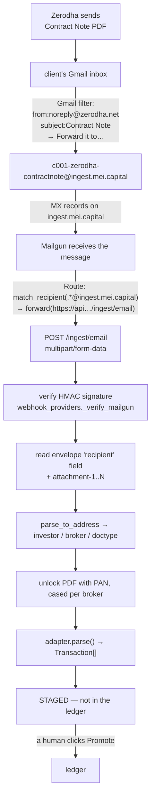
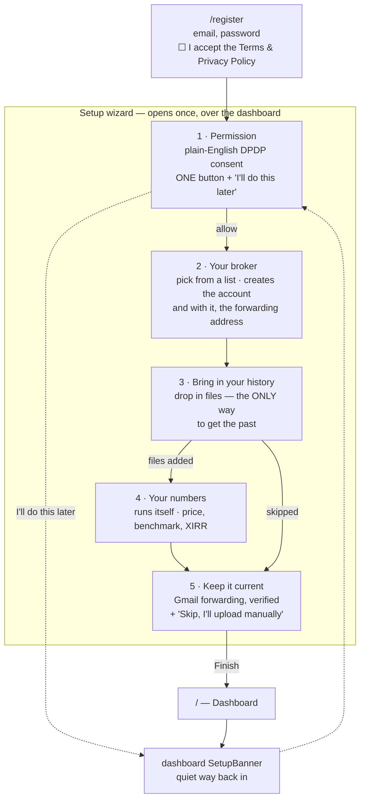

# Onboarding & inbound email — how it should work, and where it doesn't

> Written 2026-09-07 against the code on `backup-safe-checkpoint`. Every claim below
> names the file it came from. Nothing here has been changed yet — this is the map.

---

## Part 0 — The two things you asked about

### 0.1 The inbound domain vs. the forwarding address

These are not two names for the same thing. They sit at two different layers.

```
                         THE POST OFFICE                    THE PIGEONHOLE
                    ───────────────────────           ─────────────────────────
                       ingest.mei.capital        c001-zerodha-contractnote@ingest.mei.capital
                    ───────────────────────           ─────────────────────────
   what it is       a DNS + Mailgun fact          a string we compute, per account
   how many         exactly ONE, forever          one per (investor, broker, doctype)
   who creates it   you, once, in Cloudflare      app/ingest/addresses.py, on every read
   where it lives   INGEST_DOMAIN env var         nowhere — never stored in a row
   what it answers  "where does mail land?"       "whose mail is this, and what is it?"
```

| | Inbound domain | Forwarding address |
|---|---|---|
| Example | `ingest.mei.capital` | `c001-zerodha-contractnote@ingest.mei.capital` |
| Set in | `INGEST_DOMAIN` ([config.py:32](../trackr-backend/app/config.py#L32)) | derived: `{investor_code}-{broker}-{doctype}@{INGEST_DOMAIN}` |
| Built by | you, in DNS (MX records) | [addresses.py:16](../trackr-backend/app/ingest/addresses.py#L16) |
| Changes when | never (it's your MX) | a new account is added, or a new adapter is registered |
| Given to a user | no — it's infrastructure | yes — this is the thing they paste into Gmail |

**The local part *is* the routing table.** There is no database lookup that says "this
address belongs to that account". The address is parsed back apart on arrival
([webhook.py:69](../trackr-backend/app/ingest/webhook.py#L69)) and the three segments
answer three questions:

```
   c001    -    zerodha    -    contractnote    @  ingest.mei.capital
   ────         ───────         ────────────       ──────────────────
   which        which           which parser       the ONE domain whose
   investor     account         to run             MX points at Mailgun
```

That is why the domain is a single env var and the address is never stored: the address
is *derived*, exactly like holdings are derived from transactions. Same discipline.

### 0.2 The full mail path, end to end



Two details in that chain that matter and are easy to get wrong:

1. **We route on Mailgun's `recipient` form field, not the `To:` header**
   ([webhook_providers.py:132](../trackr-backend/app/ingest/webhook_providers.py#L132)).
   That is correct and deliberate. When Gmail auto-forwards, the `To:` header still says
   the *client's own* Gmail address — the original recipient. Only the SMTP envelope
   recipient is our ingest address. Routing on `To:` would break every forwarded message.
2. **Nothing auto-commits.** The webhook stages; a human promotes
   ([webhook.py:13](../trackr-backend/app/ingest/webhook.py#L13)). Mail arriving on its
   own must never write to an append-only ledger unattended.

### 0.3 What you actually need to configure for `mei.capital`

You said Mailgun is already set up. Here is the exact, complete list — and note what is
**not** on it.

**In DNS (Cloudflare or wherever `mei.capital` is hosted):**

```
ingest.mei.capital.   MX  10  mxa.mailgun.org.
ingest.mei.capital.   MX  10  mxb.mailgun.org.
```

> Use a **subdomain**. If you put MX records on `mei.capital` itself, Mailgun starts
> receiving *all* mail for the domain — including yours. `ingest.` is the whole point of
> the "inbound domain" being separate from your brand domain.
> DKIM/SPF/DMARC records are for *sending*; inbound routing does not need them.

**In Mailgun → Receiving → Routes** (one route, that's it):

| field | value |
|---|---|
| Priority | `0` |
| Expression | `match_recipient(".*@ingest\.mei\.capital")` |
| Action 1 | `forward("https://<your-backend-host>/ingest/email")` |
| Action 2 | `stop()` |

Keep the message format as Mailgun's **fully parsed** POST, not raw MIME — our
translator reads the `recipient`, `attachment-count` and `attachment-1..N` form fields
([webhook_providers.py:80](../trackr-backend/app/ingest/webhook_providers.py#L80)),
which only exist in the parsed shape.

**In the backend environment:**

```bash
INGEST_DOMAIN=ingest.mei.capital
INGEST_WEBHOOK_PROVIDER=mailgun
INGEST_MAILGUN_SIGNING_KEY=<Mailgun → Settings → Webhooks → HTTP webhook signing key>
INGEST_MAX_ATTACHMENT_BYTES=26214400   # optional; 25 MiB, matches Mailgun's own cap
```

**In the frontend environment:**

```bash
NEXT_PUBLIC_INGEST_DOMAIN=ingest.mei.capital   # display only — see note
```

**What you do NOT need:**

- **No Mailgun API sending key.** Nothing in the ingestion path sends mail. The only
  secret the code reads is the *HTTP webhook signing key*, and it is used solely to
  verify that an inbound POST really came from Mailgun
  ([webhook_providers.py:111](../trackr-backend/app/ingest/webhook_providers.py#L111)).
- **No SMTP settings** for this feature. `SMTP_*` in `.env.example` is for price-pipeline
  failure alerts, a different subsystem. (You *will* need it, or a Mailgun sending key,
  the day you want to email an import summary — see Defect 4.)

**Why the placeholder exists at all.** `ingest.example.com` is not a bug or an
oversight — `example.com` is reserved by RFC 2606 precisely so it can never resolve and
can never collide with a real address. It is only usable in `DEBUG=true`; outside DEBUG
the app *refuses to start* with it still set
([config.py `_validate_ingest_domain`](../trackr-backend/app/config.py)). So the fix is
one env var, not a code change.

**One frontend caveat.** `NEXT_PUBLIC_INGEST_DOMAIN` is used in exactly one place, and
only to build an *illustrative* example string
([AccountOnboarding.tsx:115](../trackr-frontend/app/components/AccountOnboarding.tsx#L115)).
Every real address the UI shows comes from the account API's `forwarding_addresses`
field. That is the right design — the frontend must never construct an address itself,
because only the backend knows which `(broker, doctype)` pairs have a working parser.

---

## Part 1 — What the flow *should* be

### 1.1 The confusion at the centre of it: "grant access" means two different things

You asked: *"i am confused, grant access will be at login page as terms and policy right?"*

There are **two separate legal records**, and today the product has one of them in the
wrong place and the other missing entirely.

```
┌──────────────────────────────────────────┬──────────────────────────────────────────┐
│  A.  TERMS OF SERVICE + PRIVACY POLICY   │  B.  DPDP PROCESSING CONSENT             │
├──────────────────────────────────────────┼──────────────────────────────────────────┤
│  a contract between you and the person   │  permission to process ONE data          │
│  using the software                      │  principal's financial statements        │
│                                          │                                          │
│  attaches to: the LOGIN ACCOUNT          │  attaches to: the INVESTOR               │
│  asked at:    registration               │  asked at:    before first ingestion     │
│  count:       one per user, forever      │  count:       one per investor, and an   │
│                                          │               adviser may own many       │
│  withdrawable: no (you close the account)│  withdrawable: YES, and it must stop     │
│                                          │                processing when withdrawn │
│  stored as:   a ToS version on the user  │  stored as:   client_consent row, with   │
│                                          │               notice_version + evidence  │
├──────────────────────────────────────────┼──────────────────────────────────────────┤
│  STATUS TODAY: ❌ does not exist          │  STATUS TODAY: ✅ exists and is enforced │
│  (no checkbox on /register or /login)    │  (require_consent → 403 on ingestion)    │
└──────────────────────────────────────────┴──────────────────────────────────────────┘
```

So the answer is: **yes and no.**

- The *terms and policy* checkbox belongs on the registration page. It is missing. Add it.
- The *DPDP consent* cannot live on the login page, because a login can own several
  investors and each one needs its own consent record with its own withdrawal switch.
  It belongs exactly where it is — step 1 of the wizard — and there must be **only one
  of it in the whole product**.

Today there are two UIs writing the same record — the wizard step
([GrantAccessStep.tsx](../trackr-frontend/app/components/onboarding/GrantAccessStep.tsx))
and the Settings panel
([ConsentCapture.tsx](../trackr-frontend/app/components/ConsentCapture.tsx)) — with
different evidence strings and one of them broken (Defect 1). That duplication is the
source of "why did it not save?".

### 1.2 The flow



**Why files come before forwarding, even though you wanted forwarding second.**
Forwarding buys you nothing on day one. A person who only sets up forwarding sees an
empty dashboard until their next trade — possibly weeks. Files are what make the product
work in the next sixty seconds. Forwarding is what stops them ever having to do it
again, which is a *retention* feature, not an *activation* feature. Put it last, when
they have already seen their portfolio and have a reason to care.

If you still want forwarding at step 2, the honest version is a fork:

```
   2 · How should we get your trades?
       ┌───────────────────────────────────┬───────────────────────────────────┐
       │  Upload files                     │  Forward my broker's emails       │
       │  ✅ works immediately             │  ⏳ works from your next trade on │
       │  ✅ gets your full history        │  ❌ gets you nothing about the past│
       │  10 minutes of downloading        │  3 minutes, once, then never again│
       └───────────────────────────────────┴───────────────────────────────────┘
                      most people need BOTH — that is fine, and it should say so
```

### 1.3 What each screen writes, and what "skip" means

| Screen | Writes to DB | Writes to browser | On skip |
|---|---|---|---|
| Register | `app_user` + ToS version *(missing today)* | JWT | n/a — mandatory |
| 1 Permission | `client_consent` row via `POST /investors/{id}/consent` | — | closes wizard, raises dashboard banner |
| 2 Broker | `account` row via `POST /investors/{id}/accounts` | — | cannot skip — nothing downstream works without an account |
| 3 Files | `import_batch` + `document` (staged, **not** ledger) | — | jump to 5 |
| 4 Numbers | prices, snapshots | — | not skippable; it is over in seconds |
| 5 Forwarding | nothing — the address is derived | `onboarding_done` | closes, marks done |
| Finish | — | `onboarding_done` | **navigate to `/`** |

The rule that keeps this honest: **only screens 1 and 2 write anything a user could not
undo by closing the tab.** Everything else is either staged (reversible by discarding a
batch) or derived (recomputable).

---

## Part 2 — The past and the future are two different problems

This is the part the current wizard gets most wrong, and the part you correctly spotted:

> *"currently it will show setup gmail forwarding but it only gets new mails, but we need
> old mails' PDFs as well"*

Exactly right. Gmail forwarding — both the "forward a copy of incoming mail" setting and
a filter's *Forward it to* action — applies **only to mail that arrives after the rule is
created**. Gmail never retroactively forwards. So:

```
        THE PAST                                 THE FUTURE
   ┌────────────────────────┐              ┌────────────────────────┐
   │ 3 years of contract    │              │ every trade from       │
   │ notes already sitting  │              │ tomorrow onward        │
   │ in the inbox           │              │                        │
   └───────────┬────────────┘              └───────────┬────────────┘
               │                                       │
        forwarding CANNOT                       forwarding is
        reach these                             perfect for these
               │                                       │
               ▼                                       ▼
   ┌────────────────────────┐              ┌────────────────────────┐
   │ Option A: download     │  ✅ WORKS    │ Gmail filter →         │  ⚠️ BLOCKED
   │ from broker console    │     TODAY    │ Forward it to <addr>   │   by Defect 2
   │ → drop into step 3     │              │                        │
   ├────────────────────────┤              └────────────────────────┘
   │ Option B: forward each │  ✅ WORKS
   │ old email one by one   │     TODAY
   ├────────────────────────┤
   │ Option C: select 50 →  │  ❌ BROKEN
   │ Forward as attachment  │   Defect 3
   └────────────────────────┘
```

**Option A is the one to put in the UI**, and it is what step 3 already does. Console
downloads are complete, dated, and machine-clean; a three-year-old forwarded email is a
lottery. The wizard's own help text already says this — it just says it about Zerodha only
([FileUploadStep.tsx:353](../trackr-frontend/app/components/onboarding/FileUploadStep.tsx#L353)).

**Option C is the one you described** ("go to the search bar, select all CDSL or NSDL or
broker notes, forward to the given address"). It is the right instinct and it does not
work today — see Defect 3. Gmail's bulk *"Forward as attachment"* wraps each selected
message as a nested `.eml` file, and nothing in the ingestion layer unwraps `.eml`.
Every one of those 50 messages would be rejected as an unreadable file type.

**And a second problem with the CDSL/NSDL half of that idea**: there is no CAS adapter.
The registry has exactly one entry — `("zerodha", "contractnote")`
([webhook.py:41](../trackr-backend/app/ingest/webhook.py#L41)) — so
`c001-cdsl-cas@…` is documentation, not a working address. Mail sent there gets a 422.
`docs/INGESTION.md` is explicit that this address is illustrative. Do not put it in the UI
until the adapter exists.

---

## Part 3 — Defect register

Each one is a real, verified defect with the line that causes it.

### Defect 1 — 🔴 The "Allow and continue" button does not grant anything

**This is the "it doesn't save to the DB" bug.**

There are two buttons on step 1, and only one of them works:

```
  ┌───────────────────────────────────────────────────────────────┐
  │  Let's set up your portfolio                                  │
  │  …three promises…                                             │
  │                                                               │
  │  ┌─────────────────────────────────────────────────────────┐  │
  │  │        Allow and continue  ›                            │  │ ← GrantAccessStep.tsx:208
  │  └─────────────────────────────────────────────────────────┘  │   POSTs consent ✅
  │                                                               │   creates account ✅
  │  ─────────────────────────────────────────────────────────    │
  │  I'll do this later                    [ Allow and continue ] │ ← OnboardingWizard.tsx:143
  └───────────────────────────────────────────────────────────────┘   setStepIndex(+1) only ❌
```

The footer button at
[OnboardingWizard.tsx:160-167](../trackr-frontend/app/components/onboarding/OnboardingWizard.tsx#L160-L167)
is labelled "Allow and continue" but its `onClick` only advances the step index. It never
calls `grant()`. So a user who clicks the footer — the button in the position every wizard
in the world puts the primary action — gets:

- no `client_consent` row → every later upload returns **403** ([consent.py `require_consent`](../trackr-backend/app/db/consent.py))
- no `account` row, because `ensureAccount` is inside `grant()` too ([GrantAccessStep.tsx:257](../trackr-frontend/app/components/onboarding/GrantAccessStep.tsx#L257))
- → step 5 then shows *"No forwarding address yet"*, because there is no account to derive one from

**Fix:** exactly what you said. One primary action, the inline one, plus the existing
"I'll do this later". On step 1 the footer renders the skip link only.

### Defect 2 — 🔴 Gmail's forwarding confirmation code goes into a black hole

Step 5 tells the user:

> *"Gmail sends a confirmation to that address. We handle it — nothing for you to click."*
> — [GmailForwardStep.tsx:16](../trackr-frontend/app/components/onboarding/GmailForwardStep.tsx#L16)

**Nothing handles it.** Gmail will not forward to any address until that address is
verified, and it verifies by mailing a confirmation code (and link) to it. That mail:

- has **no attachment** — `handle_inbound_email` loops over an empty attachment list and returns `[]` ([webhook.py:174](../trackr-backend/app/ingest/webhook.py#L174))
- carries the code in the **body**, and `_translate_mailgun` never reads `body-plain` ([webhook_providers.py:130](../trackr-backend/app/ingest/webhook_providers.py#L130))
- is from `forwarding-noreply@google.com`, which no code anywhere looks for

So the code is received, silently discarded, and the user can never finish Gmail's setup.
**This blocks the entire forwarding feature end to end** — not just the copy, the feature.

**Fix (this is a real build, not a copy edit):**
1. `_translate_mailgun` also returns `sender` and `body-plain`.
2. A pre-routing branch in `handle_inbound_email`: sender is `forwarding-noreply@google.com`
   → extract the 9-digit code, store it against the investor, return 200, stage nothing.
3. Step 5 polls for it and shows: **"Your code: 123456789 — paste this back into Gmail."**
   (Auto-clicking the confirmation link is possible, but showing the code is honest, is
   one line of UI, and keeps the human in the loop on a permission grant.)

### Defect 3 — 🟠 Bulk historical forwarding silently fails

Selecting old mail and using Gmail's *Forward as attachment* produces one message with N
`message/rfc822` (`.eml`) attachments. The PDF is nested one level inside each. Nothing
unwraps that: `file_validation.classify` sniffs the container, finds neither PDF nor CSV
nor XLSX, and rejects. **Fix:** in `handle_inbound_email`, if an attachment's content-type
is `message/rfc822`, parse it with `email.message_from_bytes` and recurse into its own
attachments. About twenty lines, and it turns the bulk-backfill flow you described from
impossible into a supported path.

### Defect 4 — 🟠 The person is never told their forwarded mail arrived

`docs/INGESTION.md` specifies *"email the investor an import summary"* as the last step of
the flow. It is not implemented. Combined with staging-not-committing, the experience is:
forward an email → nothing visibly happens → check the Import page days later. Either send
the summary mail or push an in-app notification, but the loop has to close somewhere.

### Defect 5 — 🟠 Step 5 tells people to forward their entire inbox

> *"choose **Forward a copy of incoming mail to** that address, then Save Changes."*
> — [GmailForwardStep.tsx:18-20](../trackr-frontend/app/components/onboarding/GmailForwardStep.tsx#L18-L20)

That Gmail setting forwards **everything** — bank mail, personal mail, all of it. It
directly contradicts the promise made four screens earlier ("nothing else in your
account") and it is a data-minimisation problem under DPDP, not just bad UX.

The Settings version of this walkthrough gets it right — it uses *Filter messages like
this → Forward it to*
([EmailForwardingSetup.tsx:72](../trackr-frontend/app/components/EmailForwardingSetup.tsx#L72)).
**Fix:** the wizard step should use the filter-based instructions, and there should be one
component, not two. Delete the wizard's copy and reuse `EmailForwardingSetup`.

### Defect 6 — 🟡 "Finish" leaves you wherever you were

`close(true)` sets state and calls `markDone`
([OnboardingWizard.tsx:100-105](../trackr-frontend/app/components/onboarding/OnboardingWizard.tsx#L100-L105)).
It does not navigate. The wizard is mounted in `Shell`
([Shell.tsx:67](../trackr-frontend/app/components/Shell.tsx#L67)), so it opens over
whatever page you happened to be on — including `/settings`, which is exactly what you
saw. **Fix:** `router.push("/")` on finish. Someone who just finished setup wants the
thing they signed up for, which is the dashboard.

### Defect 7 — 🟡 Two consent UIs, one record, different evidence strings

`GrantAccessStep` writes `evidence_ref: "onboarding wizard"`; `ConsentCapture` writes
`"in-app consent checkbox"`. Both hardcode `NOTICE_VERSION = "2026-08-consent-v1"`, which
must match `consent.py`'s `CURRENT_NOTICE_VERSION` — three copies of one constant that
must never drift. **Fix:** the notice version and text come from the API
(`GET /investors/{id}/consent` returns the current notice), and Settings shows *status +
withdraw*, never a second grant surface.

### Defect 8 — 🟡 Some of step 1's promises are not facts

You were right that not all of it is true. Line by line:

| Current line | Verdict |
|---|---|
| "We never ask for your broker password / No login, no OTP, no API key. Ever." | ✅ **True**, and enforced — `make lint` fails the build on a credential-shaped column name |
| "You choose what we see / …and nothing else in your account." | ⚠️ **Not true as the product currently instructs.** Step 5 tells them to forward *all* incoming mail (Defect 5). True again once Defect 5 is fixed |
| "You can undo this any time / …we stop processing immediately." | ⚠️ **Half true.** Withdrawal does stop new processing at once. It does *not* delete what is already stored — that is a separate action on the Privacy page |
| "This takes one click" (subtitle) | ❌ **False.** It currently takes two, and the more obvious of the two does nothing (Defect 1) |

### Defect 9 — 🟠 A permanent failure makes Mailgun retry for hours

`UnsupportedDocumentError` → **422**, `NoMatchingAccountError` → **404**
([main.py:261-283](../trackr-backend/app/main.py#L261-L283)). Those are the right codes
for a human caller and the wrong ones for a mail provider: Mailgun treats any non-2xx as
*try again later* and will retry the same message on a backoff schedule for hours before
giving up. A message that can never succeed should be **accepted (200), logged, and
dropped**, with the reason surfaced in the app. Keep 4xx only for "the caller is not
Mailgun" (bad signature) and 5xx for "we broke, please do retry".

### Defect 10 — 🟡 The forwarding address is guessable

`c001-zerodha-contractnote@ingest.mei.capital` — investor codes are short and
human-readable, so anyone can construct another investor's address and post documents at
it. `docs/INGESTION.md` acknowledges this openly, and the mitigation is real: the document
must *name* the account it lands in, checked by `app/db/identity.py` against PAN/client-id
before anything is staged. That is a genuine defence, not a fig leaf. But defence in depth
is cheap here — make the local part an unguessable per-account token
(`a7f3k9x2-contractnote@…`) and the attack disappears before the identity check is even
reached. This is a small migration (one column, one lookup) and is worth doing before real
clients, not after.

---

## Part 4 — "Everything is hardcoded to Zerodha"

Partly true, and the parts that are true are all in the same two places. Here is the
honest picture:

```
   ✅ ALREADY BROKER-AGNOSTIC                 ❌ HARDCODED TO ZERODHA
   ────────────────────────────               ────────────────────────
   account.broker is free TEXT                GrantAccessStep.tsx:262
     001_core.sql:40 — no enum,                 creates broker: "ZERODHA", silently
     no migration needed to add one
                                              GmailForwardStep.tsx:41
   PDF password rules, per broker               finds the zerodha account, ignores
     webhook.py:31 — zerodha, groww,            every other one
     upstox already differ
                                              FileUploadStep.tsx:353
   Forwarding addresses derive per               "Sign in to Zerodha Console"
     broker from the adapter registry
     addresses.py:16                           ImportTab.tsx:32,282
                                                dropdown says "Zerodha tradebook"
   /ingest/files classifies each file
     on content, picks its own adapter         _ADAPTER_FACTORIES = { (zerodha,
     ingest.py:389 — no broker declared          contractnote) } — webhook.py:41
                                                the only parser that exists
   EmailForwardingSetup handles any
     broker, and says so honestly when
     a broker has no adapter yet
```

So the architecture is fine — the *schema* has never been Zerodha-specific. What is
missing is (a) a UI that asks which broker, and (b) more parsers.

**The fix that matters most is (a), and it is small:**

1. **Add a broker step.** Replace the silent `broker: "ZERODHA"` with a picker. The list
   comes from the backend, which already knows which brokers it can do what for.
2. **One broker registry, served by the API**, not three lists in three components:
   ```
   { code: "ZERODHA", name: "Zerodha",
     pdf_password: "PAN, uppercase",
     console_steps: [...],                    ← replaces FileUploadStep's hardcoded help
     adapters: ["contractnote", "tradebook"], ← empty list is allowed and honest
     forwarding: true }
   ```
   A broker with `adapters: []` still works — the account exists, files go through
   content classification, forwarding is simply not offered. That is the honest answer,
   and much better than pretending or than blocking the signup.
3. **`GmailForwardStep` iterates every account**, not `find(zerodha)`.

**Be careful not to over-promise here.** Making the *UI* multi-broker is a day's work.
Making the *parsers* multi-broker is per-broker work that needs real sample documents.
Adding a broker picker without saying which brokers actually parse would turn a clear
"we only do Zerodha today" into a silent failure at upload time. The picker must show
what each broker supports.

---

## Part 5 — Suggested step-1 copy

Plain English, and every line is true after Defect 5 is fixed.

> ### Your permission, before anything else
>
> We need your OK to read the statements you send us. Here is exactly what that covers.
>
> **We never ask for your broker login**
> No password, no OTP, no API key — not now, not ever. We only read files you give us.
>
> **You decide what reaches us**
> You upload files, or you set up a rule that forwards only your broker's statement
> emails. Nothing else in your inbox is sent to us or seen by us.
>
> **You can turn this off whenever you want**
> Withdraw permission in Settings and we stop processing new files straight away. To
> delete what we already hold, use Erase on the Privacy page.
>
> [ Allow and continue  › ]
>
> *Read the exact wording ▸* — (the verbatim DPDP notice, unchanged)
>
> `I'll do this later`

One primary button. One skip link. The legal sentence stays exactly as it is, in the
disclosure — it is the sentence that makes this a document-processing service rather than
a regulated data intermediary, so it may be moved down the page but never reworded.

---

## Part 6 — Suggested order of work

| # | Work | Size | Unblocks |
|---|---|---|---|
| 1 | Set `INGEST_DOMAIN` + Mailgun route + signing key | config only | everything below |
| 2 | Defect 1 — one button on step 1 | ~20 lines | consent actually saving |
| 3 | Defect 6 — `router.push("/")` on finish | 2 lines | landing on the dashboard |
| 4 | Defect 8 + Part 5 — rewrite step 1 copy | copy only | honesty |
| 5 | Defect 5 — wizard reuses `EmailForwardingSetup`'s filter steps | ~1 file deleted | not forwarding the whole inbox |
| 6 | Defect 2 — capture Gmail's confirmation code | ~80 lines, FE + BE | **forwarding working at all** |
| 7 | Part 4 — broker picker + broker registry endpoint | ~1 day | multi-broker signup |
| 8 | Defect 3 — unwrap `.eml` attachments | ~20 lines | bulk historical forwarding |
| 9 | Defect 9 — 2xx on permanent failures | ~10 lines | no Mailgun retry storms |
| 10 | Defect 4 — import summary notification | ~half day | closing the loop |
| 11 | Defect 10 — unguessable address token | small migration | before real clients |
| 12 | ToS/Privacy checkbox on `/register` | ~half day | Part 1.1's missing record A |

Items 1–5 are a single session and fix everything you can see on screen. Item 6 is the one
that turns forwarding from a screen into a feature.
